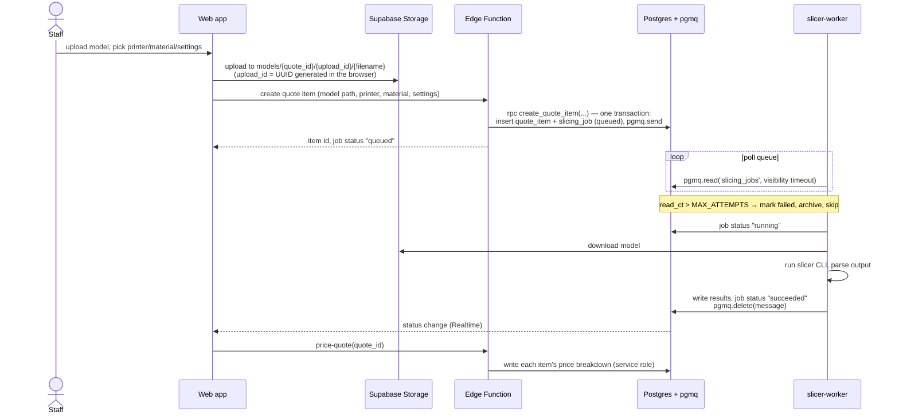
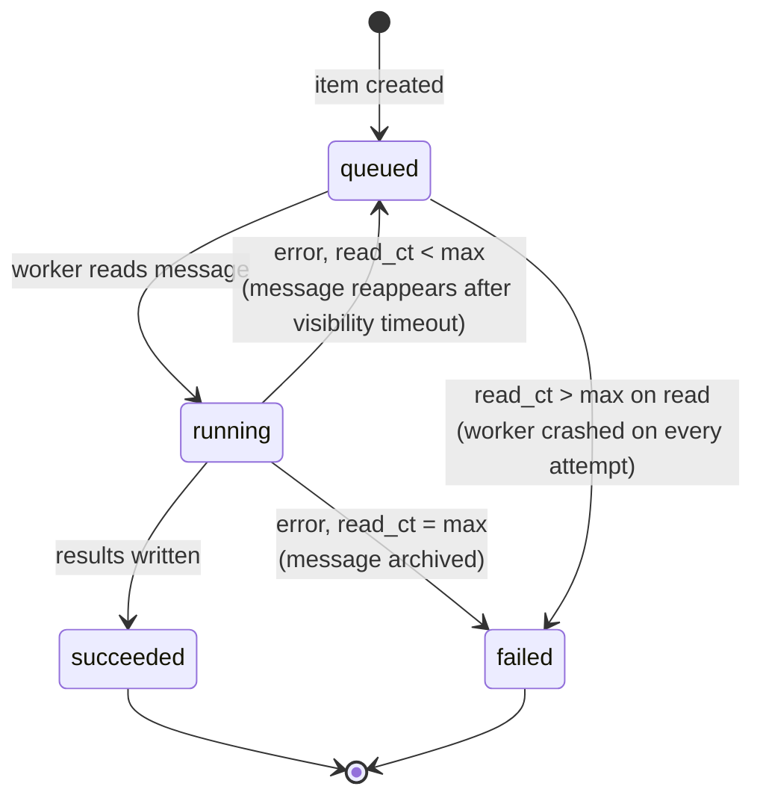

# Architecture overview

3D-Quote is a web app backed by Supabase, plus one Python worker that does the slicing. Everything the web app
reads and writes goes through Supabase; the worker is the only component that runs outside it.

## Components

| Component | Location | Technology | Responsibility |
|---|---|---|---|
| Web app | `apps/web/` | React + Vite + TypeScript | Staff UI: manage printers, materials, clients and quotes; upload models; show results. Talks to Supabase with `supabase-js`. |
| Database | Supabase Postgres (`supabase/migrations/`) | Postgres + pgmq | All business data (see [data model](../supabase/data-model.md)) and the slicing job queue. |
| File storage | Supabase Storage | Private bucket `models` | Uploaded model files. |
| Auth | Supabase Auth | Email login | Staff accounts. Row Level Security limits data to authenticated staff. |
| Edge Functions | `supabase/functions/` | Deno + TypeScript | Server-side actions that need the service role: pricing a draft (`price-quote`) and duplicating a quote (`duplicate-quote`). See [Edge Functions](../supabase/edge-functions.md). |
| slicer-worker | `services/slicer-worker/` | Python (uv), headless slicer CLI | Consume slicing jobs, run the slicer, write print time and filament usage back. See [slicer-worker](../services/slicer-worker.md). |

## Data flow

Creating and slicing one quote item:

The model is uploaded **before** the quote item exists, so its storage key can't contain the item id (ids are
generated by Postgres). The browser generates a random `upload_id` for the key instead —
`models/<quote_id>/<upload_id>/<filename>` — and the item stores the resulting path. A file uploaded but never attached to an item is an orphan; a periodic cleanup can remove objects
no `quote_items.model_path` points to.

The item row, the job row and the queue message are created by **one Postgres function**, `create_quote_item`,
called once through `rpc`. Separate `insert` / `rpc` calls from an Edge Function would each be their own transaction
and could leave a job row without a message (stuck in `queued` forever) or the other way round. The function is
`security definer` because the `authenticated` role has no rights on pgmq; it checks staff access itself (see
[data model → Access](../supabase/data-model.md#access)).

## Job lifecycle

- A message read from pgmq is invisible to other readers for the **visibility timeout**. If the worker crashes,
  the message becomes visible again and is retried — no job is lost.
- Each read increments the message's read count (`read_ct`). When a handled error happens on the last allowed
  attempt, the worker records the error, marks the job `failed` and archives the message.
- A model that **crashes the worker** (out of memory, killed container) never reaches the error handler, so the
  limit is also enforced **on read**: a message with `read_ct > MAX_ATTEMPTS` is marked `failed` and archived
  without being processed. Without this check such a message would be retried forever.
- Re-slicing an item (e.g. after changing settings) creates a new job; old jobs stay as history.

## Security

- The **web app** uses the Supabase anon key and the logged-in staff member's session. Every table has Row Level
  Security; only authenticated staff can read or write.
- The **slicer-worker** uses service-role credentials and a direct database connection. It is never exposed to the
  internet; if it has an HTTP surface at all (open question below), it is only a health check for the container
  platform.
- The `models` bucket is private. The web app uploads with the staff session; the worker downloads with the
  service role.
- Secrets (service-role key, database URL) live in environment variables and are never committed; `.env` files
  are git-ignored and only `.env.example` is tracked.

## Open questions

- **Slicer CLI:** PrusaSlicer or OrcaSlicer — affects profile format and output parsing.
- **Worker hosting:** which container platform, and always-on vs. scale-to-zero.
- **Worker HTTP surface:** whether anything beyond `/healthz` is needed (e.g. a manual re-run endpoint), or whether
  FastAPI is needed at all.
