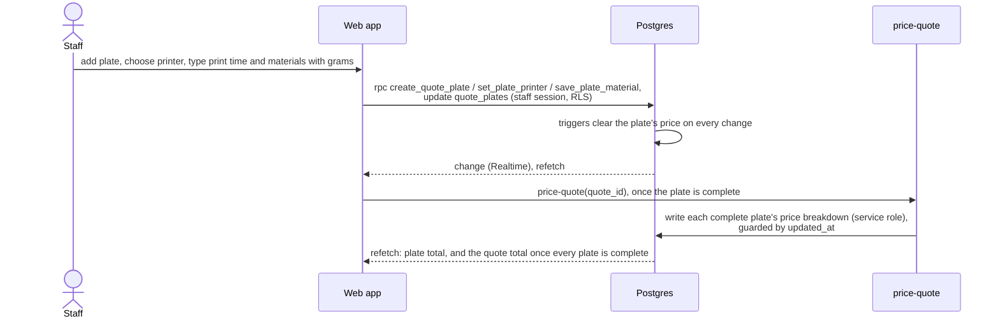

# Architecture overview

3D-Quote is a web app backed by Supabase. Everything the web app reads and writes goes through Supabase. A Python
slicer-worker was planned to slice uploaded models; uploads and slicing were removed when quote plates replaced quote
items (see below), and the worker is not wired to anything.

## Components

| Component | Location | Technology | Responsibility |
|---|---|---|---|
| Web app | `apps/web/` | React + Vite + TypeScript | Staff UI: manage printers, materials, clients, consumables and quotes; type each quote plate's printer, print time and materials; show prices. Talks to Supabase with `supabase-js`. |
| Database | Supabase Postgres (`supabase/migrations/`) | Postgres | All business data (see [data model](../supabase/data-model.md)). |
| File storage | Supabase Storage | Private buckets `models`, `branding` | The shop logo; `models` holds files of the former upload flow and waits for the new one. |
| Auth | Supabase Auth | Email login | Staff accounts. Row Level Security limits data to authenticated staff. |
| Edge Functions | `supabase/functions/` | Deno + TypeScript | Server-side actions that need the service role: pricing a draft (`price-quote`) and duplicating a quote (`duplicate-quote`). See [Edge Functions](../supabase/edge-functions.md). |
| slicer-worker | `services/slicer-worker/` | Python (uv), headless slicer CLI | Not in use: its queue and database functions were dropped with quote items. See [slicer-worker](../services/slicer-worker.md). |

## Data flow

Pricing one quote plate:

Each change runs as one statement or one `security definer` function, so the draft check (`quote_not_draft`) and the
price invalidation happen in the same transaction as the change.

## Security

- The **web app** uses the Supabase anon key and the logged-in staff member's session. Every table has Row Level
  Security; only authenticated staff can read or write.
- **Edge Functions** use the service role for the writes staff may not make (prices, quote copies) and check the
  caller's staff session first.
- The `models` and `branding` buckets are private.
- Secrets (service-role key, database URL) live in environment variables and are never committed; `.env` files
  are git-ignored and only `.env.example` is tracked.

## Open questions

- **Uploads and slicing:** how the coming upload system feeds plates (it was designed around the slicer-worker:
  PrusaSlicer or OrcaSlicer, worker hosting, its HTTP surface). A separate, implemented route is the
  [plate-extractor](../services/plate-extractor.md), which reads figures from an already sliced `.gcode.3mf`;
  its hosting and the web upload UI are still open.
