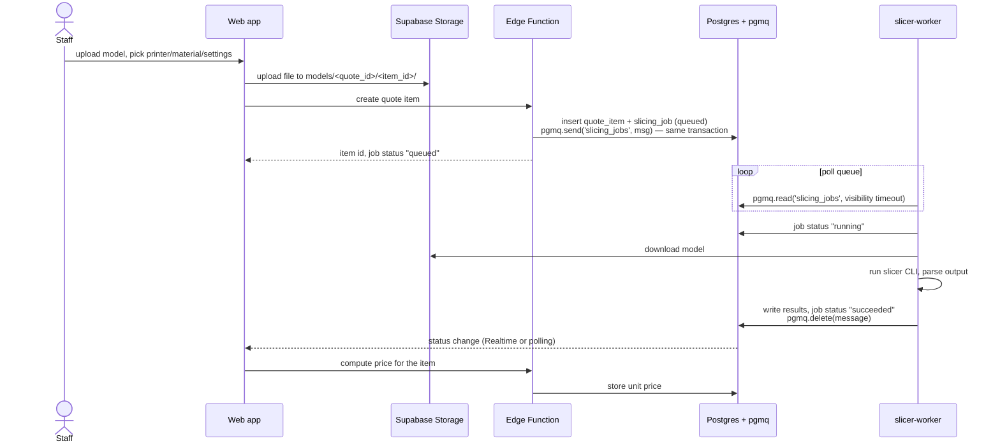
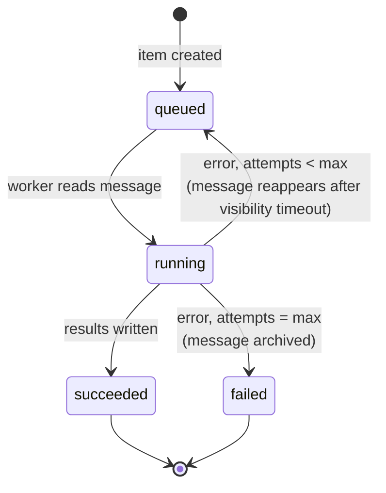

# Architecture overview

3D-Quote is a web app backed by Supabase, plus one Python worker that does the slicing. Everything the web app
reads and writes goes through Supabase; the worker is the only component that runs outside it.

## Components

| Component | Location | Technology | Responsibility |
|---|---|---|---|
| Web app | `apps/web/` | React + Vite + TypeScript | Staff UI: manage printers, materials, clients and quotes; upload models; show results. Talks to Supabase with `supabase-js`. |
| Database | Supabase Postgres (`supabase/migrations/`) | Postgres + pgmq | All business data (see [data model](../supabase/data-model.md)) and the slicing job queue. |
| File storage | Supabase Storage | Private bucket `models` | Uploaded model files. |
| Auth | Supabase Auth | Email login | Staff accounts. Row Level Security limits data to authenticated staff. |
| Edge Functions | `supabase/functions/` | Deno + TypeScript | Server-side actions the browser shouldn't do alone: create a quote item and enqueue its slicing job, compute prices. |
| slicer-worker | `services/slicer-worker/` | Python (uv), headless slicer CLI | Consume slicing jobs, run the slicer, write print time and filament usage back. See [slicer-worker](../services/slicer-worker.md). |

## Data flow

Creating and slicing one quote item:

Inserting the job row and sending the queue message in one transaction means a job is never queued without its
row, or the other way round.

## Job lifecycle

- A message read from pgmq is invisible to other readers for the **visibility timeout**. If the worker crashes,
  the message becomes visible again and is retried — no job is lost.
- Each read increments the message's read count. When it reaches the maximum number of attempts, the worker
  records the error, marks the job `failed` and archives the message so it stops being retried.
- Re-slicing an item (e.g. after changing settings) creates a new job; old jobs stay as history.

## Security

- The **web app** uses the Supabase anon key and the logged-in staff member's session. Every table has Row Level
  Security; only authenticated staff can read or write.
- The **slicer-worker** uses service-role credentials and a direct database connection. It is never exposed to the
  internet; its only HTTP endpoint is a health check for the container platform.
- The `models` bucket is private. The web app uploads with the staff session; the worker downloads with the
  service role.
- Secrets (service-role key, database URL) live in environment variables and are never committed; `.env` files
  are git-ignored and only `.env.example` is tracked.

## Open questions

- **Slicer CLI:** PrusaSlicer or OrcaSlicer — affects profile format and output parsing.
- **Where pricing runs:** an Edge Function or a SQL function (could be triggered when slicing succeeds).
- **Worker hosting:** which container platform, and always-on vs. scale-to-zero.
- **Status updates:** Supabase Realtime subscription vs. polling from the web app.
- **Worker HTTP surface:** whether anything beyond `/healthz` is needed (e.g. a manual re-run endpoint), or whether
  FastAPI is needed at all.
