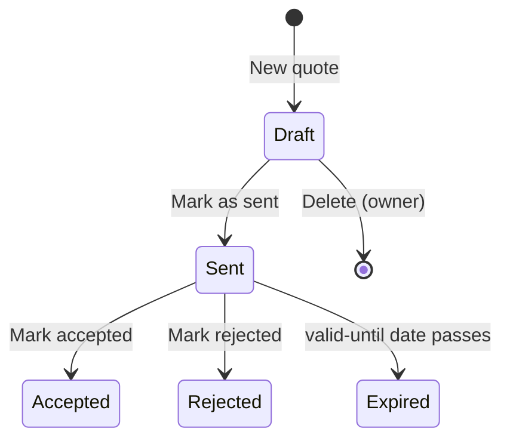

# Web app — functional analysis

- **Status:** Draft — awaiting review
- **Date:** 2026-10-11
- **App:** `apps/web/` (React + Vite + TypeScript; see the [developer guide](web-app.md))

This document describes what the web app does, screen by screen, and the rules behind it. It does not prescribe
components, libraries or visual design. Background: [product overview](../product/overview.md),
[architecture overview](../architecture/overview.md), [data model](../supabase/data-model.md).

## 1. Scope and users

The web app is the only user interface of 3D-Quote. It is used by shop staff; clients never log in and only receive
the exported PDF.

### Roles

| Role | Who | In short |
|---|---|---|
| Operator | Shop staff preparing quotes | Creates and sends quotes, manages clients. Sees rates and price breakdowns but can't change them. |
| Owner | The shop owner (one or more people) | Everything an operator can do, plus prices, rates, catalogue, staff and deletions. |

### Permission matrix

| Action | Operator | Owner |
|---|:-:|:-:|
| View quotes, clients, printers, materials, settings | ✓ | ✓ |
| Create and edit draft quotes, add/edit/remove items | ✓ | ✓ |
| Retry a failed slice | ✓ | ✓ |
| Mark a quote as sent / accepted / rejected | ✓ | ✓ |
| Duplicate a quote, export PDF | ✓ | ✓ |
| Create and edit clients | ✓ | ✓ |
| Override an item's final price, override a quote's markup | | ✓ |
| Delete quotes or clients | | ✓ |
| Create, edit, deactivate printers and materials | | ✓ |
| Edit pricing settings and shop details | | ✓ |
| Invite, remove staff and change roles | | ✓ |

Actions a user may not perform are **hidden**, not just disabled, except where a disabled control explains
something useful (e.g. operators see the price breakdown read-only). Permissions are enforced by the database
(RLS and `security definer` functions); the UI only mirrors them.

## 2. Navigation and layout

- **Sidebar** with: Quotes (home), Clients, Printers, Materials, Settings (owner sees it editable, operator
  read-only), Staff (owner only). At the bottom: the current user's name, language switcher, Account, Log out.
- **Desktop** (≥ 1024 px): sidebar always visible; lists are tables.
- **Opening a row to edit:** in the Quotes, Clients, Printers and Materials lists each row has an Edit (pencil)
  button, and double-clicking the row does the same. For quotes and clients that opens the quote editor or the client
  page; for printers and materials, the edit sheet (owners only). Names and numbers in the lists are not links, and a
  single click does nothing. Staff has no edit form, so it has neither.
- **Tablet** (768–1023 px): sidebar collapses to an icon rail / drawer; tables keep their key columns and hide the
  rest; every action reachable by touch.
- Below 768 px the app remains usable but is not optimised (see [§8](#8-non-functional-requirements)).
- Every list and detail page has its own URL, so pages can be bookmarked and the browser back button works.

## 3. Screens

Each screen lists what it shows, what the user can do, validation, and its empty / loading / error states.
Common behaviour applies everywhere:

- **Loading:** skeletons in place of content; never a blank page.
- **Errors:** a non-blocking message with a Retry action; form errors appear next to the field.
- **Unsaved changes:** leaving a form with unsaved changes asks for confirmation.
- **Destructive actions** (delete, remove staff) always ask for confirmation naming the thing being deleted.

### 3.1 Login

- Email + password. "Forgot password" sends a reset email.
- Staff are **invited** by an owner (see [3.9](#39-staff)); the invitation email leads to a page where the new user
  sets their password and name.
- There is no sign-up. A user who authenticates but has no staff record sees "Your account has no access to
  3D-Quote — ask the owner" and nothing else.
- The session persists across browser restarts until the user logs out.

### 3.2 Quotes list (home)

**Shows** a table of quotes, newest first:

| Column | Notes |
|---|---|
| Number | e.g. `Q-2026-0042` |
| Client | Name (company if present) |
| Status | Badge: Draft, Sent, Accepted, Rejected, Expired |
| Total | Sum of item totals; "—" while any item is not yet priced |
| Created | Date, and who created it |
| Valid until | Date; highlighted when it falls within 7 days for sent quotes |

**Actions**
- **New quote** (primary button).
- **Search** by quote number or client name/company.
- **Filter** by status (multi-select), client, created date range. Filters are kept in the URL.
- **Sort** by number, created, valid until, total.
- Click a row to open the quote. Pagination: 25 per page.

**Empty state:** "No quotes yet" with a New quote button. With filters active: "No quotes match these filters" with
a Clear filters action.

### 3.3 New quote

A short dialog:

| Field | Rules |
|---|---|
| Client | Required. Search existing clients by name/company/email; **Create new client** inline (same fields as 3.4). |
| Valid until | Required. Defaults to today + default validity (settings). Must be today or later. |
| Notes | Optional; printed on the PDF. |
| Markup override | Owner only. Optional %; when empty the default markup applies. |

On save the quote gets its number (see [§5.4](#54-quote-numbers)), status Draft, and the quote editor opens.

### 3.4 Quote detail / editor

The main screen. Layout: header, items, totals.

**Header**
- Number, status badge, client (link to client), created by/at, valid until, notes, markup in effect (default or
  override).
- In Draft, the client, valid until, notes and (owner) markup override are editable in place.
- Actions, depending on status (see [§4](#4-quote-lifecycle)): Mark as sent, Mark accepted, Mark rejected,
  Duplicate, Export PDF, Delete (owner).

**Adding items**
- A drop zone and a **Choose files** button (the button is the primary path on tablet). Multiple files at once.
- Accepted: `.stl`, `.3mf`. Maximum size per file: 100 MB (proposed). Rejected files are listed with the reason and
  nothing is uploaded for them.
- Each accepted file shows an upload progress bar; once uploaded it becomes an item with default settings:
  - printer and material: the ones used on the previous item of this quote, otherwise none selected;
  - quantity 1, layer height 0.20 mm, infill 20 %, supports off.
- An item is sent for slicing as soon as it has a printer and a material. Until then it shows
  "Choose printer and material".

**Item card** (one per item)

| Part | Content |
|---|---|
| Description | Defaults to the file name without extension; editable; printed on the PDF. |
| File | Original file name and a download link. The size isn't shown: it isn't stored on the item. |
| Settings | Printer (active printers only), material (active materials only, shown with colour), quantity, layer height, infill, supports. Editable in Draft. |
| Slicing | Status and results — see [§7](#7-slicing-as-the-user-sees-it). |
| Results | Print time per copy (h:mm), filament per copy (g), bounding box (mm). |
| Price | Item total and unit price; expandable **price breakdown** (see [§5](#5-pricing-rules)). |

Rules when editing a Draft item:
- Changing **printer, material, layer height, infill or supports** discards the current results and slices the item
  again. The previous price disappears until the new results arrive.
- Changing **quantity** or **description** does not re-slice; quantity re-prices immediately.
- **Remove item** asks for confirmation and deletes the item and its file.

**Price override (owner only)**
- On an item's breakdown: **Override price** sets the item total by hand and requires a reason (free text, shown
  to staff only). The breakdown keeps the computed value and shows the override beside it.
- **Remove override** returns to the computed price.

**Totals**
- **Net total** = sum of item totals; **VAT** = net × VAT rate, rounded half-up to the cent; **Total incl. VAT**.
  Shown with currency, formatted for the user's language. A draft uses the shop's VAT rate (Settings); marking the
  quote as sent freezes the rate on the quote.
- **Recalculate prices** (Draft only): re-prices every item with the current settings and rates. Prices are also
  recalculated automatically whenever an item changes or a slice finishes.

**Empty state:** "Add model files to start" over the drop zone.

### 3.5 Clients

**List:** name, company, email, phone, number of quotes, last quote date. Search by name/company/email. New client.

**Client form**

| Field | Rules |
|---|---|
| Name | Required, 1–200 characters. |
| Company | Optional. |
| Email | Optional; valid email format when present. |
| Phone | Optional; free text. |
| Notes | Optional; internal, never printed. |

**Client detail:** the form plus the client's quotes (same columns as the quotes list) and a **New quote for this
client** action.

**Delete (owner only):** allowed only when the client has no quotes; otherwise the action explains why it's
unavailable.

### 3.6 Printers

**List:** name, model, type, hourly rate, power, active. Operators see it read-only.

**Printer form (owner)**

| Field | Rules |
|---|---|
| Name | Required, unique. |
| Model | Required. |
| Type | FDM or SLA; FDM is preselected for a new printer. For now it is only recorded and shown: it does not change slicing, pricing or which materials can be chosen. |
| Hourly rate method | *Enter directly* (default) or *Calculate from purchase cost*. A printer saved with a purchase cost reopens in the second mode. |
| Machine rate (per hour) | *Enter directly*: required, ≥ 0. Wear and depreciation only — energy is separate. |
| Purchase cost, estimated life (hours) | *Calculate from purchase cost*: both required; cost > 0, life a whole number of hours > 0. The machine rate is purchase cost ÷ life, rounded to cents, and shown under the fields as you type. Both are kept, so they can be corrected later. Switching back to *Enter directly* keeps the calculated rate in the field and clears the purchase figures. |
| Power (W) | Required, > 0. Average draw while printing; used for energy cost. |
| Failure rate (%) | Whole number from 0 to 100; default 0. For now it is only recorded: pricing still uses the failure allowance from Settings. |
| Active | Inactive printers can't be chosen for new items; existing items keep them. |

Only the resulting machine rate is used in pricing, however it was entered. Printers used by any item can't be deleted, only deactivated. Changing a printer's rates affects Draft quotes on
their next recalculation and never affects Sent quotes.

### 3.7 Materials

**List:** name, type, colour, cost per kg, density, active. Operators see it read-only.

**Material form (owner)**

| Field | Rules |
|---|---|
| Name | Required. |
| Type | Required: PLA, PETG, ABS, ASA, TPU, PA, PC, Other. |
| Colour | Optional; free text (e.g. "Galaxy Black"). |
| Cost per kg | Required, ≥ 0. |
| Density (g/cm³) | Required, > 0. Pre-filled from the type (PLA 1.24, PETG 1.27, ABS 1.04, ASA 1.07, TPU 1.21, PA 1.14, PC 1.20). |
| Active | As for printers. |

Same delete/deactivate and rate-change rules as printers.

### 3.8 Settings

Owner edits; operators see read-only. Changes apply to Draft quotes on their next recalculation, never to Sent
quotes.

**Pricing**

| Setting | Example | Rules |
|---|---|---|
| Energy price (per kWh) | 0.30 | ≥ 0 |
| Failure allowance (%) | 10 | 0–100 |
| Setup / handling fee (per item) | 5.00 | ≥ 0 |
| Default markup (%) | 30 | ≥ 0 |
| VAT rate (%) | 22 | 0–100; applied to the quote's net total; frozen on each quote when it is sent |
| Minimum item price | 10.00 | ≥ 0 |
| Currency | EUR | ISO 4217 code; one currency for the whole shop |

**Quotes**

| Setting | Example | Rules |
|---|---|---|
| Quote number prefix | `Q` | 1–10 letters/digits |
| Default validity (days) | 30 | 1–365 |
| PDF terms | "Delivery …" | Optional; Italian and English text, printed at the bottom of the PDF in the chosen language |

**Shop details** (printed on the PDF): name, address, VAT number, email, phone, logo (PNG/JPG/SVG, ≤ 1 MB).

### 3.9 Staff

Owner only.

- **List:** name, email, role, status (Invited / Active / Inactive). Invited = invited and never signed in.
- **Invite:** name, email and role (the person's language starts as Italian). Sends the invitation email; the person
  follows the link, sets a password and is in. If the email can't be sent the app shows the link to send by hand.
- **Invitations:** Resend, Copy link, Revoke (deletes the invitation; only before the person has signed in).
- **Change role** between Operator and Owner.
- **Deactivate / Reactivate:** a deactivated person can no longer use the app, and the quotes they created keep
  showing them as creator. Your own row has no actions.
- The last remaining owner can't be demoted or deactivated.

### 3.10 Account

- Name and language (Italian / English); the language applies immediately and is remembered for the user.
- Change password.

## 4. Quote lifecycle



| Status | Editable | Allowed actions |
|---|---|---|
| Draft | Everything | Mark as sent, Duplicate, Export PDF (watermarked "DRAFT"), Delete (owner) |
| Sent | Nothing | Mark accepted, Mark rejected, Duplicate, Export PDF |
| Accepted / Rejected / Expired | Nothing | Duplicate, Export PDF |

- **Mark as sent** requires: at least one item; every item sliced and priced; valid until is
  today or later. If something is missing, the dialog lists what. On success the sent date is recorded and prices
  are frozen: later changes to rates, printers or materials never change a sent quote.
- **Expired** is set automatically once a day for Sent quotes whose valid-until date has passed.
- **Duplicate** creates a new Draft with a new number, the same client, notes and items (files are reused, not
  re-uploaded), and prices recalculated with current rates. This is how a sent quote is revised.
- Only Draft quotes can be deleted (owner). Sent and later quotes are kept as history.

## 5. Pricing rules

### 5.1 Inputs

| Input | Source |
|---|---|
| `filament_g`, `print_time_h` | Slicing results, per copy |
| `cost_per_kg` | Material |
| `machine_rate` (per hour), `power_w` | Printer |
| `energy_price` (per kWh), `failure_pct`, `setup_fee`, `minimum_price` | Settings |
| `markup_pct` | Quote override, otherwise Settings default |
| `quantity` | Item |

### 5.2 Formula (per item)

```text
material_cost   = filament_g / 1000 × cost_per_kg
machine_cost    = print_time_h × machine_rate
energy_cost     = power_w / 1000 × print_time_h × energy_price
copy_cost       = material_cost + machine_cost + energy_cost
failure_cost    = copy_cost × failure_pct / 100
production_cost = (copy_cost + failure_cost) × quantity + setup_fee
markup          = production_cost × markup_pct / 100
computed_total  = max(production_cost + markup, minimum_price)
item_total      = override_total if set, else computed_total
unit_price      = item_total / quantity
```

- The setup fee is charged **once per item**, not per copy.
- The minimum price applies to the **item total**.
- Calculations use full precision; only `item_total` and `unit_price` are rounded, to 2 decimals, half up. The
  quote total is the sum of rounded item totals.

### 5.3 Worked example

PETG at 25.00/kg, printer with machine rate 1.50/h and 120 W, energy 0.30/kWh, failure 10 %, setup fee 5.00,
markup 30 %, minimum 10.00. The slicer reports 120 g and 5 h 30 min per copy; quantity 2.

| Line | Calculation | Value |
|---|---|---|
| Material | 120 / 1000 × 25.00 | 3.0000 |
| Machine | 5.5 × 1.50 | 8.2500 |
| Energy | 0.120 × 5.5 × 0.30 | 0.1980 |
| Cost per copy | | 11.4480 |
| Failure allowance | 11.4480 × 10 % | 1.1448 |
| × quantity 2 | (11.4480 + 1.1448) × 2 | 25.1856 |
| Setup fee | | 5.0000 |
| Production cost | | 30.1856 |
| Markup | 30.1856 × 30 % | 9.0557 |
| **Item total** | max(39.2413, 10.00), rounded | **39.24** |
| Unit price | 39.24 / 2 | 19.62 |

### 5.4 Quote numbers

- Format: `<prefix>-<year>-<sequence>`, e.g. `Q-2026-0042`.
- The sequence restarts at 1 every calendar year and is zero-padded to 4 digits (it grows past 9999 if needed).
- The number is assigned when the quote is created and never changes. Deleting a draft leaves a gap; that is
  accepted for quotes.

### 5.5 What is stored

Every item stores its price breakdown (each line above, the markup % used, and any override with its reason). For
Draft quotes it is rewritten on every recalculation; once the quote is Sent it is never rewritten, so the stored
breakdown is the record of what was quoted.

## 6. PDF

Exported from the quote detail in any status. The user chooses the PDF language (Italian / English; defaults to
their UI language).

**Contents**
1. Shop logo and details (from Settings).
2. Title "Quote" / "Preventivo", number, date (sent date, or today for drafts), valid until.
3. Client block: name, company, email, phone.
4. Items table: description, material (type and colour), quantity, unit price, item total.
5. Net total, VAT (rate) and total incl. VAT, in the shop currency.
6. Quote notes.
7. PDF terms from Settings, in the chosen language.

**Not on the PDF:** cost breakdown, print times, filament weights, overrides and their reasons, internal client
notes.

Draft PDFs carry a diagonal "DRAFT" / "BOZZA" watermark.

File name: `<number>-<client name>.pdf`, e.g. `Q-2026-0042-Rossi.pdf`.

The Export PDF button is available in every status once every item has a price; it opens a dialog to choose the
language.

## 7. Slicing as the user sees it

Each item shows one slicing state. Updates appear without reloading the page.

| State | The user sees | User actions |
|---|---|---|
| Waiting for settings | "Choose printer and material" | Edit settings |
| Queued | "Waiting to slice" with a spinner | — |
| Slicing | "Slicing…" with a spinner and elapsed time | — |
| Done | Print time, filament, bounding box, price | Edit settings (re-slices) |
| Failed | "Slicing failed" + the error message in plain words | **Retry** (new slicing job), edit settings, remove item |

- An item stuck in Queued for more than 10 minutes shows "Slicing is taking longer than usual" (no action; the
  worker may be busy or down).
- Retrying after the automatic attempts are exhausted always starts a fresh job.
- While any item is Queued or Slicing, Mark as sent is disabled with a hint.

## 8. Non-functional requirements

**Languages**
- Italian and English. All UI text comes from translation files; no hard-coded strings.
- Language per user (stored on the staff record); before login, the browser language, falling back to Italian.
- Numbers, dates and currency are formatted for the active language (`it-IT`: 1.234,56 €; `en-GB`: €1,234.56).
- Data entered by staff (descriptions, notes, client names) is not translated.

**Devices and browsers**
- Desktop and tablet are fully supported; phone screens are usable but not optimised.
- Latest two versions of Chrome, Edge, Firefox and Safari (including Safari on iPad).
- Touch targets at least 44 × 44 px; nothing depends on hover or drag-and-drop alone.

**Accessibility**
- Target WCAG 2.1 AA: keyboard navigation, visible focus, labelled form fields, sufficient contrast, status not
  conveyed by colour alone (badges have text).

**Responsiveness**
- Lists load in under 1 s for 1 000 quotes on a normal connection (paginated, filtered on the server).
- Upload progress is shown for every file; a failed upload can be retried without re-selecting the file.

## 9. Impact on other docs

This analysis requires these changes, applied in the same change set:

- [Data model](../supabase/data-model.md):
  - `staff.language`;
  - `printers.power_w`;
  - new single-row `settings` table;
  - `quotes.number` (+ year and sequence), `quotes.markup_override_pct`;
  - `quote_items.description` and the price breakdown columns, replacing `unit_price`;
  - owner-only write policies, a `set_price_override` function, and a daily job that expires quotes.
- [Product overview](../product/overview.md): workflow and glossary updated with energy cost, owner-only price
  overrides and PDF export; resolved open questions removed.

## 10. Open questions

- **Default print settings:** whether the owner can configure the defaults for new items (layer height, infill,
  supports) instead of the fixed 0.20 mm / 20 % / off.
- **Maximum upload size:** 100 MB is a proposal; to be confirmed against the worker's limits.
- **Notifications:** whether staff should be notified (e.g. in-app badge) when a slice fails while they're on
  another page.
