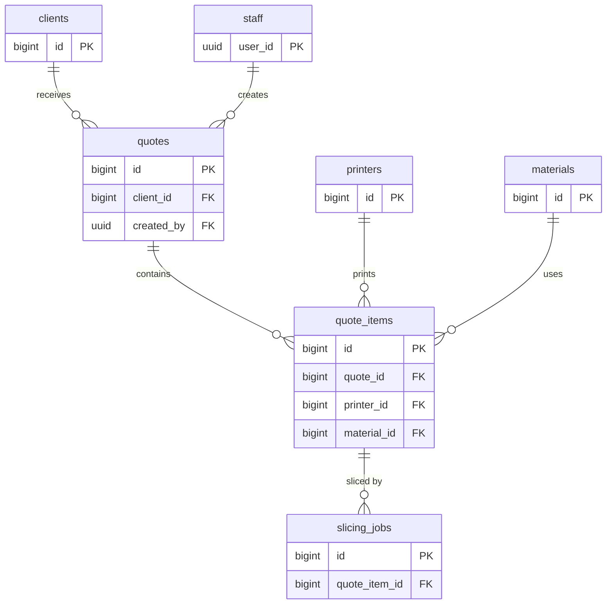

# Data model

- **Status: Draft** — nothing here is migrated yet. Tables, columns and names may change when the first migration is
  written in `supabase/migrations/`.

## Overview



## Conventions

- Lowercase `snake_case` identifiers, plural table names, all tables in the `public` schema.
- Primary keys are `bigint generated always as identity`. The only UUIDs are Supabase Auth user ids.
- Every table has `created_at timestamptz not null default now()`; mutable tables also have `updated_at`, kept
  current by a trigger.
- Money is `numeric(12,2)` in the shop's currency; never floating point.
- Statuses are `text` with a `check` constraint listing the allowed values.
- Every foreign key column gets an index (Postgres does not create one automatically).

## Tables

### `staff`

Who may use the tool. A row links a Supabase Auth user to staff access.

| Column | Type | Notes |
|---|---|---|
| `user_id` | `uuid` PK | References `auth.users(id)`, `on delete cascade` |
| `display_name` | `text` not null | |
| `role` | `text` not null default `'operator'` | Check: `operator`, `owner` |
| `created_at` | `timestamptz` | |

### `printers`

| Column | Type | Notes |
|---|---|---|
| `id` | `bigint` identity PK | |
| `name` | `text` not null unique | Shop's name for the machine, e.g. "MK4 #2" |
| `model` | `text` not null | Manufacturer model, e.g. "Prusa MK4" |
| `build_x_mm`, `build_y_mm`, `build_z_mm` | `numeric(6,1)` not null | Build volume |
| `nozzle_diameter_mm` | `numeric(3,2)` not null default `0.40` | |
| `hourly_rate` | `numeric(12,2)` not null | Machine cost per hour |
| `active` | `boolean` not null default `true` | Inactive printers can't be picked for new items |
| `created_at`, `updated_at` | `timestamptz` | |

### `materials`

| Column | Type | Notes |
|---|---|---|
| `id` | `bigint` identity PK | |
| `name` | `text` not null | e.g. "Prusament PETG Galaxy Black" |
| `type` | `text` not null | Check: `PLA`, `PETG`, `ABS`, `ASA`, `TPU`, `PA`, `PC`, `other` |
| `color` | `text` | |
| `density_g_cm3` | `numeric(4,2)` not null | Used to convert filament length to weight |
| `cost_per_kg` | `numeric(12,2)` not null | |
| `active` | `boolean` not null default `true` | |
| `created_at`, `updated_at` | `timestamptz` | |

### `clients`

| Column | Type | Notes |
|---|---|---|
| `id` | `bigint` identity PK | |
| `name` | `text` not null | Contact person or business name |
| `company` | `text` | |
| `email` | `text` | |
| `phone` | `text` | |
| `notes` | `text` | |
| `created_at`, `updated_at` | `timestamptz` | |

### `quotes`

| Column | Type | Notes |
|---|---|---|
| `id` | `bigint` identity PK | |
| `client_id` | `bigint` not null FK → `clients` | Indexed |
| `status` | `text` not null default `'draft'` | Check: `draft`, `sent`, `accepted`, `rejected`, `expired` |
| `valid_until` | `date` | |
| `notes` | `text` | Shown on the quote |
| `created_by` | `uuid` not null FK → `staff(user_id)` | Indexed |
| `sent_at` | `timestamptz` | Set when status becomes `sent` |
| `created_at`, `updated_at` | `timestamptz` | |

### `quote_items`

| Column | Type | Notes |
|---|---|---|
| `id` | `bigint` identity PK | |
| `quote_id` | `bigint` not null FK → `quotes`, `on delete cascade` | Indexed |
| `model_path` | `text` not null | Object path in the `models` bucket |
| `original_filename` | `text` not null | |
| `printer_id` | `bigint` not null FK → `printers` | Indexed |
| `material_id` | `bigint` not null FK → `materials` | Indexed |
| `quantity` | `integer` not null default `1` | Check: `> 0` |
| `layer_height_mm` | `numeric(3,2)` not null | |
| `infill_percent` | `smallint` not null | Check: `0..100` |
| `supports` | `boolean` not null default `false` | |
| `print_time_s` | `integer` | From the latest succeeded slicing job; null until sliced |
| `filament_g` | `numeric(10,2)` | Same |
| `unit_price` | `numeric(12,2)` | Price for one copy; null until priced |
| `created_at`, `updated_at` | `timestamptz` | |

### `slicing_jobs`

One row per slicing attempt series for an item. The queue message carries `job_id`; this table is the durable
record of what happened (see [slicer-worker](../services/slicer-worker.md)).

| Column | Type | Notes |
|---|---|---|
| `id` | `bigint` identity PK | |
| `quote_item_id` | `bigint` not null FK → `quote_items`, `on delete cascade` | Indexed |
| `status` | `text` not null default `'queued'` | Check: `queued`, `running`, `succeeded`, `failed` |
| `attempts` | `smallint` not null default `0` | |
| `error` | `text` | Last error message |
| `print_time_s` | `integer` | Results, see slicer-worker output |
| `filament_g`, `filament_mm` | `numeric(10,2)` | |
| `layer_count` | `integer` | |
| `bbox_x_mm`, `bbox_y_mm`, `bbox_z_mm` | `numeric(6,1)` | |
| `slicer_version` | `text` | |
| `queued_at` | `timestamptz` not null default `now()` | |
| `started_at`, `finished_at` | `timestamptz` | |

## Storage

- Private bucket **`models`**.
- Object path: `<quote_id>/<quote_item_id>/<original_filename>`.
- Staff upload and read through Storage policies that use the same staff check as the tables; the worker downloads
  with the service role.

## Queues

- pgmq queue **`slicing_jobs`**, created with Supabase Queues.
- Messages are sent by the Edge Function in the same transaction that inserts the `slicing_jobs` row.
- Message format: see [slicer-worker → Job message](../services/slicer-worker.md#job-message-proposed).

## Access

- Row Level Security is enabled on every table.
- Staff access is checked with a helper in a non-exposed `private` schema, used in policies as
  `using ((select private.is_staff()))` so it runs once per query, not once per row:

  ```sql
  create function private.is_staff() returns boolean
  language sql stable security definer set search_path = '' as $$
    select exists (select 1 from public.staff where user_id = (select auth.uid()));
  $$;
  ```

- Staff can read and write all business tables. Only `owner` may change `printers`, `materials` and `staff`
  (proposed).
- Public sign-ups are disabled in Supabase Auth; staff accounts are created by invitation. Being `authenticated`
  alone grants nothing — a `staff` row is required.
- The slicer-worker uses the service role, which bypasses RLS.

## Open questions

- **Price snapshots:** once a quote is `sent`, should printer and material rates be copied onto the items so later
  rate changes don't alter it?
- **Soft delete:** whether quotes and clients are deleted or archived.
- **Currency:** single shop currency (assumed) or per-quote currency.
- **Price breakdown:** whether `unit_price` alone is enough, or material cost, machine cost and markup should be
  stored separately.
