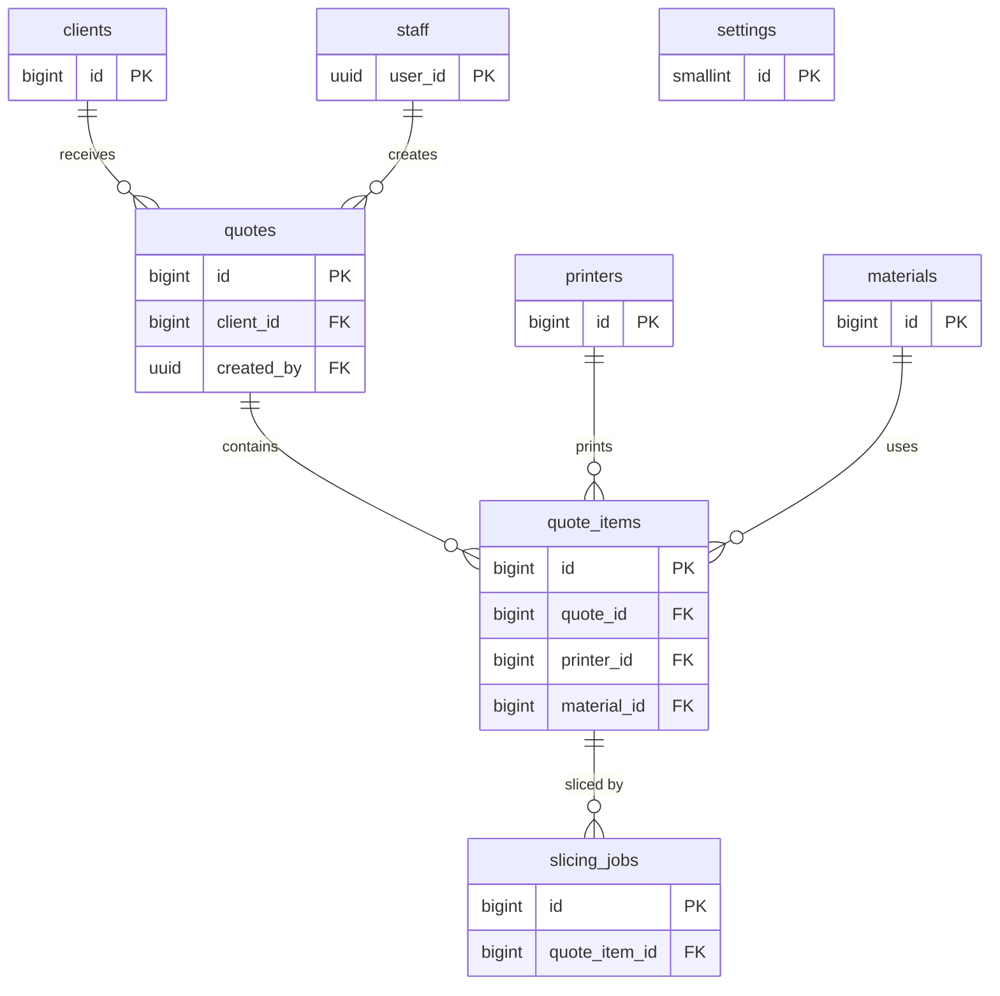

# Data model

- **Status: Draft** — nothing here is migrated yet. Tables, columns and names may change when the first migration is
  written in `supabase/migrations/`.

## Overview



## Conventions

- Lowercase `snake_case` identifiers, plural table names, all tables in the `public` schema.
- Primary keys are `bigint generated always as identity`. The only UUIDs are Supabase Auth user ids.
- Every table has `created_at timestamptz not null default now()`; mutable tables also have `updated_at`, kept
  current by a trigger.
- Money is `numeric(12,2)` in the shop's currency; never floating point.
- Statuses are `text` with a `check` constraint listing the allowed values.
- Every foreign key column gets an index (Postgres does not create one automatically).

## Tables

### `staff`

Who may use the tool. A row links a Supabase Auth user to staff access.

| Column | Type | Notes |
|---|---|---|
| `user_id` | `uuid` PK | References `auth.users(id)`, `on delete cascade` |
| `display_name` | `text` not null | |
| `role` | `text` not null default `'operator'` | Check: `operator`, `owner` |
| `language` | `text` not null default `'it'` | Check: `it`, `en`. UI language |
| `active` | `boolean` not null default `true` | `false` once removed by an owner; the row is kept so past quotes still show their creator |
| `created_at`, `updated_at` | `timestamptz` | |

Removing a staff member sets `active = false` and bans the Auth user; it never deletes the Auth user, which would
cascade to this row and break `quotes.created_by`. "Invited" vs "Active" in the UI comes from whether the Auth user
has confirmed their invitation.

### `printers`

| Column | Type | Notes |
|---|---|---|
| `id` | `bigint` identity PK | |
| `name` | `text` not null unique | Shop's name for the machine, e.g. "MK4 #2" |
| `model` | `text` not null | Manufacturer model, e.g. "Prusa MK4" |
| `build_x_mm`, `build_y_mm`, `build_z_mm` | `numeric(6,1)` not null | Build volume |
| `nozzle_diameter_mm` | `numeric(3,2)` not null default `0.40` | |
| `hourly_rate` | `numeric(12,2)` not null | Machine cost per hour (wear, depreciation); energy is separate |
| `power_w` | `integer` not null | Check: `> 0`. Average draw while printing, for energy cost |
| `active` | `boolean` not null default `true` | Inactive printers can't be picked for new items |
| `created_at`, `updated_at` | `timestamptz` | |

### `materials`

| Column | Type | Notes |
|---|---|---|
| `id` | `bigint` identity PK | |
| `name` | `text` not null | e.g. "Prusament PETG Galaxy Black" |
| `type` | `text` not null | Check: `PLA`, `PETG`, `ABS`, `ASA`, `TPU`, `PA`, `PC`, `other` |
| `color` | `text` | |
| `density_g_cm3` | `numeric(4,2)` not null | Used to convert filament length to weight |
| `cost_per_kg` | `numeric(12,2)` not null | |
| `active` | `boolean` not null default `true` | |
| `created_at`, `updated_at` | `timestamptz` | |

### `settings`

Shop-wide settings; exactly one row (`id = 1`, enforced by a check constraint). See
[functional analysis §3.8](../frontend/functional-analysis.md#38-settings).

| Column | Type | Notes |
|---|---|---|
| `id` | `smallint` PK | Check: `id = 1` |
| `currency` | `text` not null default `'EUR'` | ISO 4217 |
| `energy_price_kwh` | `numeric(8,4)` not null | |
| `failure_allowance_pct` | `numeric(5,2)` not null default `0` | Check: `0..100` |
| `setup_fee` | `numeric(12,2)` not null default `0` | Per item |
| `default_markup_pct` | `numeric(6,2)` not null default `0` | Check: `>= 0` |
| `minimum_item_price` | `numeric(12,2)` not null default `0` | |
| `quote_prefix` | `text` not null default `'Q'` | Check: 1–10 letters/digits |
| `default_validity_days` | `smallint` not null default `30` | Check: `1..365` |
| `pdf_terms_it`, `pdf_terms_en` | `text` | |
| `shop_name`, `shop_address`, `shop_vat_number`, `shop_email`, `shop_phone` | `text` | Printed on the PDF |
| `shop_logo_path` | `text` | Object path in the private `branding` bucket |
| `updated_at` | `timestamptz` | |

### `clients`

| Column | Type | Notes |
|---|---|---|
| `id` | `bigint` identity PK | |
| `name` | `text` not null | Contact person or business name |
| `company` | `text` | |
| `email` | `text` | |
| `phone` | `text` | |
| `notes` | `text` | |
| `created_at`, `updated_at` | `timestamptz` | |

### `quotes`

| Column | Type | Notes |
|---|---|---|
| `id` | `bigint` identity PK | |
| `number` | `text` not null unique | e.g. `Q-2026-0042`; built from prefix, year and sequence at insert |
| `number_year`, `number_seq` | `smallint`, `integer` not null | Unique together; the sequence restarts each year |
| `client_id` | `bigint` not null FK → `clients` | Indexed. `on delete restrict`: clients with quotes can't be deleted |
| `status` | `text` not null default `'draft'` | Check: `draft`, `sent`, `accepted`, `rejected`, `expired` |
| `valid_until` | `date` | |
| `notes` | `text` | Shown on the quote |
| `created_by` | `uuid` not null FK → `staff(user_id)` | Indexed |
| `markup_override_pct` | `numeric(6,2)` | Owner only; null = use `settings.default_markup_pct` |
| `sent_at` | `timestamptz` | Set when status becomes `sent` |
| `created_at`, `updated_at` | `timestamptz` | |

### `quote_items`

| Column | Type | Notes |
|---|---|---|
| `id` | `bigint` identity PK | |
| `quote_id` | `bigint` not null FK → `quotes`, `on delete cascade` | Indexed |
| `model_path` | `text` not null unique | Object path in the `models` bucket, uploaded before the item is created |
| `original_filename` | `text` not null | |
| `description` | `text` not null | Defaults to the file name without extension; printed on the PDF |
| `printer_id` | `bigint` FK → `printers` | Indexed. Null until chosen; slicing starts once printer and material are set |
| `material_id` | `bigint` FK → `materials` | Indexed. Same |
| `quantity` | `integer` not null default `1` | Check: `> 0` |
| `layer_height_mm` | `numeric(3,2)` not null | |
| `infill_percent` | `smallint` not null | Check: `0..100` |
| `supports` | `boolean` not null default `false` | |
| `print_time_s` | `integer` | From the latest succeeded slicing job; null until sliced |
| `filament_g` | `numeric(10,2)` | Same |
| `bbox_x_mm`, `bbox_y_mm`, `bbox_z_mm` | `numeric(6,1)` | Same; checked against the printer's build volume |
| `material_cost`, `machine_cost`, `energy_cost`, `failure_cost`, `setup_fee`, `markup_amount` | `numeric(14,4)` | Price breakdown, full precision ([pricing rules](../frontend/functional-analysis.md#5-pricing-rules)) |
| `markup_pct` | `numeric(6,2)` | Markup % used for this computation |
| `computed_total` | `numeric(12,2)` | After minimum price, rounded |
| `override_total` | `numeric(12,2)` | Owner override; null when none |
| `override_reason` | `text` | Required when `override_total` is set |
| `item_total` | `numeric(12,2)` | `override_total` if set, else `computed_total`; null until priced |
| `priced_at` | `timestamptz` | Last computation. Never changes once the quote is `sent` |
| `created_at`, `updated_at` | `timestamptz` | |

### `slicing_jobs`

One row per slicing attempt series for an item. The queue message carries `job_id`; this table is the durable
record of what happened (see [slicer-worker](../services/slicer-worker.md)).

| Column | Type | Notes |
|---|---|---|
| `id` | `bigint` identity PK | |
| `quote_item_id` | `bigint` not null FK → `quote_items`, `on delete cascade` | Indexed |
| `status` | `text` not null default `'queued'` | Check: `queued`, `running`, `succeeded`, `failed` |
| `attempts` | `smallint` not null default `0` | |
| `error` | `text` | Last error message |
| `print_time_s` | `integer` | Results, see slicer-worker output |
| `filament_g`, `filament_mm` | `numeric(10,2)` | |
| `layer_count` | `integer` | |
| `bbox_x_mm`, `bbox_y_mm`, `bbox_z_mm` | `numeric(6,1)` | |
| `slicer_version` | `text` | |
| `queued_at` | `timestamptz` not null default `now()` | |
| `started_at`, `finished_at` | `timestamptz` | |

## Storage

- Private bucket **`models`**.
- Object path: `<quote_id>/<upload_id>/<original_filename>`, where `upload_id` is a UUID generated in the browser.
  The file is uploaded before the quote item exists, so the item id can't be part of the key.
- Objects that no `quote_items.model_path` points to (upload finished, item never created) are orphans; a periodic
  cleanup removes them (proposed).
- Staff upload and read through Storage policies that use the same staff check as the tables; the worker downloads
  with the service role.

- Private bucket **`branding`** for the shop logo; owner writes, staff read.

## Queues

- pgmq queue **`slicing_jobs`**, created with Supabase Queues.
- Messages are sent only by the functions listed under [Access](#access), in the same transaction that inserts the
  `slicing_jobs` row. Separate calls from an Edge Function would each be their own transaction.

## Scheduled jobs

- **Expire quotes** (pg_cron, daily): sets `status = 'expired'` on `sent` quotes whose `valid_until` is before today.
- Message format: see [slicer-worker → Job message](../services/slicer-worker.md#job-message-proposed).

## Access

- Row Level Security is enabled on every table.
- Staff access is checked with a helper in a non-exposed `private` schema, used in policies as
  `using ((select private.is_staff()))` so it runs once per query, not once per row:

  ```sql
  create function private.is_staff() returns boolean
  language sql stable security definer set search_path = '' as $$
    select exists (select 1 from public.staff where user_id = (select auth.uid()));
  $$;

  -- Policies run as `authenticated`, which needs to reach the private schema to call the helper.
  grant usage on schema private to authenticated;
  revoke execute on function private.is_staff() from public, anon;
  grant execute on function private.is_staff() to authenticated;
  ```

- `private.is_staff()` also requires `staff.active`. A similar `private.is_owner()` checks `role = 'owner'`.
- Permissions follow the [functional analysis permission matrix](../frontend/functional-analysis.md#permission-matrix):
  - all staff read everything and write `clients`, `quotes` and `quote_items` while the quote is `draft`;
  - only owners write `printers`, `materials`, `settings` and `staff`, and delete `quotes` (draft only) and `clients`;
  - rows of quotes that are no longer `draft` are read-only for everyone except through the status functions below.
- Public sign-ups are disabled in Supabase Auth; staff accounts are created by invitation. Being `authenticated`
  alone grants nothing — a `staff` row is required.
- The slicer-worker uses the service role, which bypasses RLS.
- **Functions** (proposed). All are `security definer` with `set search_path = ''`, check `private.is_staff()` (or
  `private.is_owner()`) first and raise if it fails, and are executable by `authenticated` only. `security definer`
  is needed because `authenticated` has no rights on pgmq.
  - `create_quote_item(...)`: inserts the item; if printer and material are set, also inserts a `slicing_jobs` row
    and calls `pgmq.send` — one transaction.
  - `update_quote_item_settings(...)`: changes printer, material or print settings, clears results and price, and
    enqueues a new job the same way.
  - `retry_slicing(item_id)`: enqueues a new job for an item whose last job failed.
  - `set_price_override(item_id, total, reason)` / `clear_price_override(item_id)`: owner only, draft quotes only.
  - `mark_quote_sent(quote_id)`: checks the send conditions from the functional analysis, then sets `sent` and
    `sent_at`. `mark_quote_accepted` / `mark_quote_rejected` change `sent` quotes only.

## Open questions

- **Soft delete:** whether clients should be archivable (today they can only be deleted when they have no quotes).
- **Where pricing runs:** the formula is fixed in the functional analysis; whether it is a SQL function or an Edge
  Function is still open (see [architecture overview](../architecture/overview.md#open-questions)).
