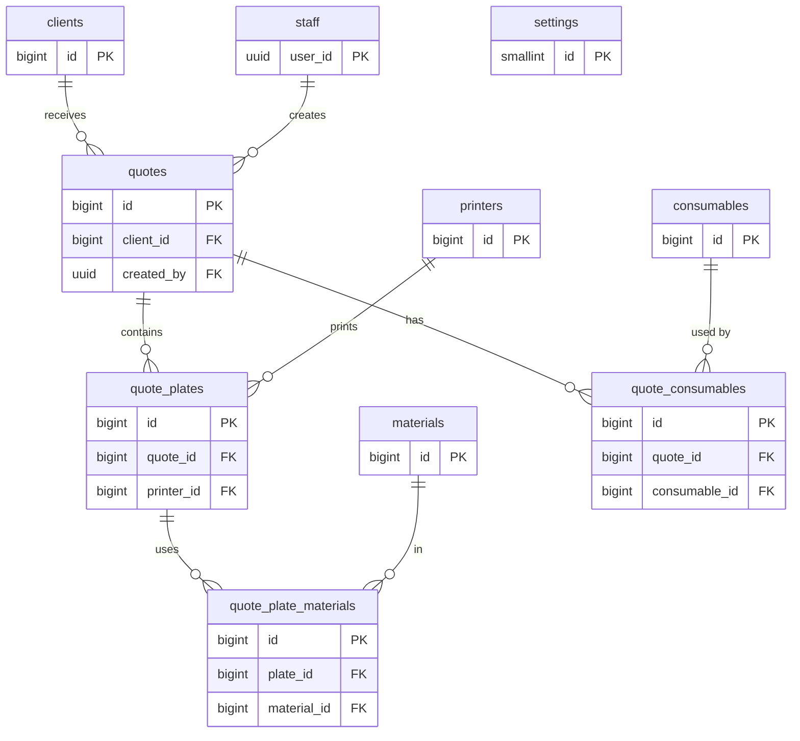

# Data model

- **Status: Implemented** — local only. Source of truth: `supabase/schemas/` and the migrations in
  `supabase/migrations/` ([ADR-0003](../architecture/adr/0003-database-schema-and-security.md)).

## Overview

Pricing runs in the [`price-quote` Edge Function](edge-functions.md). This schema stores the price breakdown, which
only the service role can write.

## Conventions

- Lowercase `snake_case` identifiers, plural table names. Application tables are in `public`; helpers and internal
  tables are in the non-exposed `private` schema.
- Primary keys are `bigint generated always as identity`. The only UUIDs are Supabase Auth user ids.
- Every table has `created_at timestamptz not null default now()`; mutable tables also have `updated_at`, kept
  current by the `private.set_updated_at()` trigger.
- Tables without user-editable state may omit `updated_at`.
- Money is `numeric(12,2)` in the shop's currency; never floating point.
- Statuses are `text` with a `check` constraint listing the allowed values.
- Every foreign key column gets an index (Postgres does not create one automatically).
- "Today" is always `private.shop_today()`, the date in `Europe/Rome`: quote number years, the send check and the
  expiry job all use it.

## Tables

### `staff`

Who may use the tool. A row links a Supabase Auth user to staff access.

| Column | Type | Notes |
|---|---|---|
| `user_id` | `uuid` PK | References `auth.users(id)`, `on delete cascade` |
| `display_name` | `text` not null | Not blank |
| `role` | `text` not null default `'operator'` | Check: `operator`, `owner` |
| `language` | `text` not null default `'it'` | Check: `it`, `en`. UI language |
| `active` | `boolean` not null default `true` | `false` once removed by an owner; the row is kept so past quotes still show their creator |
| `created_at`, `updated_at` | `timestamptz` | |

Removing a staff member sets `active = false` and bans the Auth user; it never deletes the Auth user. Deleting an
Auth user who created quotes fails on the `quotes.created_by` foreign key. "Invited" vs "Active" in the UI comes from
whether the Auth user has confirmed their invitation.

The `staff_guard` trigger (every role):
- only an owner may change `role` or `active`;
- a change that would leave no active owner raises `last_owner` (demotion, deactivation and deletion).

### `printers`

| Column | Type | Notes |
|---|---|---|
| `id` | `bigint` identity PK | |
| `name` | `text` not null unique | Shop's name for the machine, e.g. "MK4 #2" |
| `model` | `text` not null | Manufacturer model, e.g. "Prusa MK4" |
| `type` | `text` not null default `'FDM'` | Printing technology. Check: `FDM` or `SLA`. Recorded only; nothing reads it yet |
| `hourly_rate` | `numeric(12,2)` not null | Machine cost per hour (wear, depreciation); energy is separate. The only cost pricing reads. When `purchase_cost` is set it equals `purchase_cost / lifetime_hours`, rounded to cents by the web app |
| `purchase_cost` | `numeric(12,2)` null | Check: `> 0`. What the printer cost. Set only when the app derived `hourly_rate` from it |
| `lifetime_hours` | `integer` null | Check: `> 0`. Estimated life in print hours. Null exactly when `purchase_cost` is (check `printers_purchase_pair`) |
| `power_w` | `integer` not null | Check: `> 0`. Average draw while printing, for energy cost |
| `failure_rate` | `integer` not null default `0` | Check: `0` to `100`. Percent added to the cost of a copy to cover failed prints on this machine; pricing reads it |
| `active` | `boolean` not null default `true` | Inactive printers can't be picked for plates |
| `created_at`, `updated_at` | `timestamptz` | |

### `materials`

| Column | Type | Notes |
|---|---|---|
| `id` | `bigint` identity PK | |
| `name` | `text` not null | e.g. "Prusament PETG Galaxy Black" |
| `type` | `text` not null | Check: `PLA`, `PETG`, `ABS`, `ASA`, `TPU`, `PA`, `PC`, `other` |
| `color` | `text` | |
| `density_g_cm3` | `numeric(4,2)` not null | Used to convert filament length to weight |
| `cost_per_kg` | `numeric(12,2)` not null | |
| `active` | `boolean` not null default `true` | Inactive materials can't be added to plates |
| `created_at`, `updated_at` | `timestamptz` | |

### `consumables`

Bought-in goods used in an assembly (bolts, screws, inserts…), with a stock counter. Added by the `consumables` and
`consumables_setup` migrations; declared in `supabase/schemas/06_consumables.sql`.

| Column | Type | Notes |
|---|---|---|
| `id` | `bigint` identity PK | |
| `name` | `text` not null unique | Not blank |
| `unit` | `text` not null default `'pcs'` | Not blank. Shown next to the stock (the web app pre-fills `pz`) |
| `unit_price` | `numeric(12,2)` not null | Check: `>= 0`. Sale price per unit; no markup is added |
| `stock` | `integer` not null default `0` | Check: `>= 0`. Units available; sending a quote deducts from it |
| `active` | `boolean` not null default `true` | Inactive consumables can't be added to quotes |
| `created_at`, `updated_at` | `timestamptz` | |

### `settings`

Shop-wide settings; exactly one row (`id = 1`, enforced by a check constraint), inserted by the `grants_and_setup`
migration. See [functional analysis §3.8](../frontend/functional-analysis.md#38-settings).

| Column | Type | Notes |
|---|---|---|
| `id` | `smallint` PK | Check: `id = 1` |
| `currency` | `text` not null default `'EUR'` | ISO 4217 |
| `energy_price_kwh` | `numeric(8,4)` not null default `0` | |
| `setup_fee` | `numeric(12,2)` not null default `0` | Per plate |
| `default_markup_pct` | `numeric(6,2)` not null default `0` | Check: `>= 0` |
| `minimum_item_price` | `numeric(12,2)` not null default `0` | Minimum total of a plate (the name predates plates) |
| `vat_rate_pct` | `numeric(5,2)` not null default `22` | Check: `0..100`. The shop's VAT rate; draft quotes follow it |
| `quote_prefix` | `text` not null default `'Q'` | Check: 1–10 letters/digits |
| `default_validity_days` | `smallint` not null default `30` | Check: `1..365` |
| `pdf_terms_it`, `pdf_terms_en` | `text` | |
| `shop_name`, `shop_address`, `shop_vat_number`, `shop_email`, `shop_phone` | `text` | Printed on the PDF |
| `shop_logo_path` | `text` | Object path in the private `branding` bucket |
| `created_at`, `updated_at` | `timestamptz` | |

### `clients`

| Column | Type | Notes |
|---|---|---|
| `id` | `bigint` identity PK | |
| `name` | `text` not null | Contact person or business name |
| `company` | `text` | |
| `email` | `text` | |
| `phone` | `text` | |
| `notes` | `text` | |
| `created_at`, `updated_at` | `timestamptz` | |

### `quotes`

| Column | Type | Notes |
|---|---|---|
| `id` | `bigint` identity PK | |
| `number` | `text` not null unique | e.g. `Q-2026-0042`; built from prefix, year and sequence at insert |
| `number_year`, `number_seq` | `smallint`, `integer` not null | Unique together; the sequence restarts each year |
| `client_id` | `bigint` not null FK → `clients` | Indexed. `on delete restrict`: clients with quotes can't be deleted |
| `status` | `text` not null default `'draft'` | Check: `draft`, `sent`, `accepted`, `rejected`, `expired` |
| `valid_until` | `date` not null | Default today + `settings.default_validity_days` (Europe/Rome) |
| `notes` | `text` | Shown on the quote |
| `created_by` | `uuid` not null default `auth.uid()`, FK → `staff(user_id)` | Indexed |
| `markup_override_pct` | `numeric(6,2)` | Owner only; null = use `settings.default_markup_pct`. Check: `>= 0` |
| `vat_rate_pct` | `numeric(5,2)` | Null while the quote is a draft; `mark_quote_sent` copies `settings.vat_rate_pct` here and it never changes afterwards. Check `quotes_vat_rate_check`: null exactly when `status = 'draft'` |
| `sent_at` | `timestamptz` | Set when status becomes `sent` |
| `created_at`, `updated_at` | `timestamptz` | |

Partial index `(valid_until) where status = 'sent'` serves the expiry job.

Numbers come from `private.quote_counters` (one row per year, `year smallint` PK, `last_seq integer`) in a
before-insert trigger; supplied values are replaced. The sequence is zero-padded to 4 digits and grows past 9999
without being cut.

The `quotes_guard` trigger (every role, the service role included): once a quote leaves `draft`, the only allowed
change is `status` moving from `sent` to `accepted`, `rejected` or `expired`. Anything else, including deleting the
quote, raises `quote_not_draft`.

### `quote_plates`

One print job: everything printed together, supports and other extras included. Added by the `quote_plates`
migration (which turned every former quote item into a plate with the same id); declared in
`supabase/schemas/06_quote_plates.sql`.

| Column | Type | Notes |
|---|---|---|
| `id` | `bigint` identity PK | |
| `quote_id` | `bigint` not null FK → `quotes`, `on delete cascade` | Indexed |
| `description` | `text` not null | Not blank. The web app names new plates "Plate 1", "Plate 2"…; printed on the PDF |
| `printer_id` | `bigint` FK → `printers`, `on delete restrict` | Indexed. Null until chosen |
| `print_time_s` | `integer` | Check: `> 0`. Typed by hand (h:mm in the web app); null until set |
| `quantity` | `integer` not null default `1` | Check: `> 0`. Copies of the plate |
| `material_cost`, `machine_cost`, `energy_cost`, `failure_cost`, `setup_fee`, `markup_amount` | `numeric(14,4)` | Price breakdown, full precision ([pricing rules](../frontend/functional-analysis.md#5-pricing-rules)) |
| `markup_pct` | `numeric(6,2)` | Markup % used for this computation |
| `computed_total` | `numeric(12,2)` | After minimum price, rounded |
| `override_total` | `numeric(12,2)` | Owner override; null when none |
| `override_reason` | `text` | Required when `override_total` is set |
| `plate_total` | `numeric(12,2)` generated always as `coalesce(override_total, computed_total)` stored | Null until priced |
| `priced_at` | `timestamptz` | Last computation. Never changes once the quote is `sent` |
| `created_at`, `updated_at` | `timestamptz` | |

Check `quote_plates_override_check`: `override_total` is null, or it is `>= 0` and `override_reason` is not blank.

A plate is **complete** when it has a printer, a print time and at least one material row. Only complete plates are
priced, and a quote has a total only when it has plates and every one is complete and has a `plate_total`: an
override on an incomplete plate does not make the total appear.

Triggers (every role, the service role included):
- `quote_plates_guard`: an update or delete raises `quote_not_draft` unless the parent quote is `draft` (the cascade
  from deleting a draft quote is allowed), and moving a plate to another quote raises `quote_plate_move_not_allowed`.
  It takes `FOR SHARE` on the quote, so it waits for a concurrent send.
- `quote_plates_reprice`: a change of `quantity`, `printer_id` or `print_time_s` clears the price breakdown
  (`material_cost` … `markup_pct`, `computed_total`, `priced_at`); the override stays.

### `quote_plate_materials`

The materials of a plate, each with its weight per copy. Declared in `supabase/schemas/06_quote_plates.sql`.

| Column | Type | Notes |
|---|---|---|
| `id` | `bigint` identity PK | |
| `plate_id` | `bigint` not null FK → `quote_plates`, `on delete cascade` | Unique together with `material_id` (a material appears once per plate) |
| `material_id` | `bigint` not null FK → `materials`, `on delete restrict` | Indexed |
| `grams` | `numeric(10,2)` not null | Check: `> 0`. Per copy, supports included |
| `created_at`, `updated_at` | `timestamptz` | |

Triggers (every role, the service role included):
- `quote_plate_materials_guard`: an insert, update or delete raises `quote_not_draft` unless the plate's quote is
  `draft` (cascades are allowed), and moving a row to another plate raises `quote_plate_move_not_allowed`.
- `quote_plate_materials_reprice` (after insert, update, delete; `security definer`): clears the parent plate's price
  breakdown, which also bumps its `updated_at`.

The four trigger functions are in `private`; the `quote_plates` migration revokes `execute` on them from `public`,
`anon` and `authenticated`.

### `quote_consumables`

The consumable lines of a quote. A quote may have none.

| Column | Type | Notes |
|---|---|---|
| `id` | `bigint` identity PK | |
| `quote_id` | `bigint` not null FK → `quotes`, `on delete cascade` | Unique together with `consumable_id` |
| `consumable_id` | `bigint` not null FK → `consumables`, `on delete restrict` | Indexed. A consumable used by a quote can't be deleted, only deactivated |
| `quantity` | `integer` not null | Check: `> 0` |
| `unit_price` | `numeric(12,2)` not null | Check: `>= 0`. Copied from the consumable when the line is added; never follows later price changes |
| `line_total` | `numeric(12,2)` generated always as `quantity * unit_price` stored | |
| `created_at`, `updated_at` | `timestamptz` | |

Triggers:
- `quote_consumables_guard` (every role, the service role included): an insert, update or delete raises
  `quote_not_draft` unless the parent quote is `draft` (the cascade from deleting a draft quote is allowed), and
  moving a line to another quote raises `quote_item_move_not_allowed` (a name kept from before plates). It takes
  `FOR SHARE` on the quote, so it waits for a concurrent send.
- `quotes_return_stock` (on `quotes`, after `status` changes): when a quote goes from `sent` to `rejected` or
  `expired`, every line's quantity is added back to the consumable's stock. This covers `mark_quote_rejected` and the
  daily `expire-quotes` job. An `accepted` quote keeps the stock deducted.

Both are `security definer` functions in `private`; the `consumables_setup` migration revokes `execute` on them from
`public`, `anon` and `authenticated`, since trigger functions in `private` get no default revoke.

## Views

### `quotes_list`

The quotes list (home page). `security_invoker = true`, so the caller's RLS on `quotes`, `clients`, `staff`,
`quote_plates`, `quote_plate_materials` and `quote_consumables` applies: users who aren't active staff see no rows. Declared in `supabase/schemas/08_quotes_list.sql`.

A migration generated with `supabase db diff` recreates the view with `create or replace view` and drops
`security_invoker`, which would show every quote to anyone who can select from the view. Any change to the view
therefore needs `alter view public.quotes_list set (security_invoker = true);` added to its migration by hand.

| Column | Notes |
|---|---|
| `id`, `number`, `number_year`, `number_seq`, `status`, `client_id`, `valid_until`, `sent_at`, `created_at`, `created_by` | From `quotes` |
| `client_name`, `client_company` | From `clients` |
| `created_by_name` | `staff.display_name` of the creator |
| `created_on` | `created_at` as a date in `Europe/Rome`, for the date filter |
| `plate_count` | Number of plates |
| `total` | Sum of `plate_total` plus the quote's consumable lines (`line_total`); null when there are no plates or any plate is incomplete or unpriced (an override on an incomplete plate included) |

## Realtime

`quote_plates` and `quote_plate_materials` are in the `supabase_realtime` publication (migration `quote_plates`;
the declarative schema can't express publications). The quote editor subscribes to them; Realtime applies each table's
`select` RLS, so only active staff receive changes.

## Storage

- Private bucket **`models`**, 100 MB per file, no MIME restriction (browsers report STL and 3MF types
  inconsistently). Nothing uploads to it since plates replaced items; it stays for the coming upload system.
- Object path: `<quote_id>/<upload_id>/<original_filename>`, where `upload_id` is a UUID generated in the browser
  (the layout of the former upload flow, which the policies below still expect).
- Upload rule: the first folder must be the id of a `draft` quote (`private.can_upload_model(name)`).
- Change rule: files in the folder of a quote that has left `draft` can't be moved or deleted by staff
  (`private.can_change_model(name)`); folders of deleted quotes stay removable.
- Private bucket **`branding`** for the shop logo, 1 MB, `image/png`, `image/jpeg`, `image/svg+xml`.

Policies on `storage.objects`, all `to authenticated` (declared in `supabase/schemas/30_storage.sql`):

| Policy | Rule |
|---|---|
| `models: staff read` | staff, `models` bucket |
| `models: staff upload to draft quotes` | `private.can_upload_model(name)` |
| `models: staff update in draft quotes` | `private.can_change_model(name)`; the new name must pass `private.can_upload_model(name)` |
| `models: staff delete` | `private.can_change_model(name)` |
| `branding: staff read` | staff |
| `branding: owner upload` | owner |
| `branding: owner update` | owner |
| `branding: owner delete` | owner |

## Queues

None. The `slicing_jobs` pgmq queue, the `slicing_jobs` table and the worker functions were dropped with
`quote_items` (migration `quote_plates_cutover`).

## Scheduled jobs

- **`expire-quotes`** (pg_cron, `15 0 * * *`, 00:15 UTC): `private.expire_quotes()` sets `status = 'expired'` on
  `sent` quotes whose `valid_until` is before `private.shop_today()`.

## Access

- Row Level Security is enabled on every table in `public` and `private`. `private.quote_counters` has no policies;
  only the numbering trigger reaches it.
- `private.is_staff()` is true when the caller has a `staff` row with `active = true`; `private.is_owner()` also
  requires `role = 'owner'`. Both are `security definer`, `stable`, `set search_path = ''`, and policies call them as
  `(select private.is_staff())` so they run once per statement, not once per row.
- Public sign-ups are disabled in Supabase Auth; staff accounts are created by invitation. Being `authenticated`
  alone grants nothing — a `staff` row is required.
- Edge Functions use the service role, which bypasses RLS but not the triggers.

### Grants

Since the 2026 Data API change every grant is explicit. `anon` gets nothing. `authenticated` gets `select` on every
public table plus these writes; `service_role` gets `all`.

| Table | insert | update | delete |
|---|---|---|---|
| `staff` | ✓ | `display_name`, `language`, `role`, `active` | — |
| `printers`, `materials`, `clients` | ✓ | ✓ | ✓ |
| `settings` | — | every column except `id` | — |
| `quotes` | `client_id`, `valid_until`, `notes` | `client_id`, `valid_until`, `notes` | ✓ |
| `quote_plates` | — (created by function) | `description`, `quantity`, `print_time_s` | ✓ |
| `quote_plate_materials` | — (added by function) | `grams` | ✓ |
| `consumables` | ✓ | ✓ | ✓ |
| `quote_consumables` | — (created by function) | `quantity` | ✓ |
| `quotes_list` (view) | — | — | — |

`quotes_list` is readable by `authenticated` and `service_role` only.

### RLS policies

Every policy is `to authenticated`. UPDATE policies have both `using` and `with check`.

| Table | select | insert | update | delete |
|---|---|---|---|---|
| `staff` | staff | owner | owner, or the row's own user | — |
| `printers`, `materials` | staff | owner | owner | owner |
| `settings` | staff | — | owner | — |
| `clients` | staff | staff | staff | owner |
| `quotes` | staff | staff | staff, while `status = 'draft'` | owner, while `status = 'draft'` |
| `quote_plates` | staff | — | staff, parent quote draft | staff, parent quote draft |
| `quote_plate_materials` | staff | — | staff, plate's quote draft | staff, plate's quote draft |
| `consumables` | staff | owner | owner | owner |
| `quote_consumables` | staff | — | staff, parent quote draft | staff, parent quote draft |

### Functions

Each function in `public` is a `security invoker` SQL wrapper that calls the same-named `security definer` function
in `private`. The private function has `set search_path = ''`, checks `private.is_staff()` or `private.is_owner()`
first, and raises one of the [errors](#errors) below. EXECUTE is revoked from `public` and `anon` everywhere and
granted only as listed. Internal helpers (`require_staff`, `require_owner`, `require_draft_quote`,
`require_active_catalog`, `mark_quote_outcome`, `expire_quotes`) are
`security invoker` and granted to nobody. The storage helpers `can_upload_model` and `can_change_model` are
`security definer` and granted to `authenticated` for the storage policies.

**Web app functions** (`authenticated`):

| Function | Who | Does |
|---|---|---|
| `list_staff() → table(user_id uuid, display_name text, email text, role text, language text, active boolean, created_at timestamptz, last_sign_in_at timestamptz)` | owner | Every staff row with the login email from `auth.users` (which the API can't read), ordered by display name. `last_sign_in_at` is `auth.users.last_sign_in_at` (null = never signed in, which the app shows as Invited). Raises `owner_required` for anyone else. |
| `create_quote_plate(quote_id bigint, description text, printer_id bigint default null) → bigint` | staff | Draft only. Description not blank (`invalid_description`); a printer, if given, must be active. Inserts a plate with quantity 1 and no print time; returns its id. Description, quantity and print time are then edited directly through the table. |
| `set_plate_printer(plate_id bigint, printer_id bigint) → void` | staff | Draft only (`plate_not_found`). The same printer again does nothing; a new one must be active. |
| `save_plate_material(plate_id bigint, material_id bigint, grams numeric) → bigint` | staff | Draft only. `grams > 0` (`invalid_grams`). Sets the grams of the plate's row for that material, or adds the row (the material must be active). Returns the row id. Rows are deleted directly through the table. |
| `set_markup_override(quote_id bigint, pct numeric) → void` | owner | Draft only. `pct >= 0` or null. Clears every plate's price breakdown. |
| `set_price_override(plate_id bigint, total numeric, reason text) → void` | owner | Draft only. `total >= 0`, reason not blank. |
| `clear_price_override(plate_id bigint) → void` | owner | Draft only |
| `get_quote_send_blockers(quote_id bigint) → table(quote_plate_id bigint, code text)` | staff | Empty means the quote can be sent |
| `add_quote_consumable(quote_id bigint, consumable_id bigint, quantity integer) → bigint` | staff | Draft only. The consumable must be active (`consumable_inactive`). Inserts a line at the consumable's current price, or adds `quantity` to the existing line of that consumable (the line keeps its original price). Returns the line id. Lines are edited (`quantity`) and deleted directly through the table. |
| `mark_quote_sent(quote_id bigint) → void` | staff | Locks the quote's consumables (`FOR UPDATE`, in id order, so two sends can't spend the same stock), then raises `quote_not_sendable` if there are blockers; otherwise deducts each line's quantity from the stock, sets `sent` and `sent_at = now()` and freezes the VAT rate |
| `mark_quote_accepted(quote_id bigint)`, `mark_quote_rejected(quote_id bigint) → void` | staff | `sent` quotes only |

**Send blockers:**

| Code | When |
|---|---|
| `not_draft` | Quote is not `draft` (no plate id; reported alone) |
| `no_plates` | Quote has no plates (no plate id) |
| `valid_until_past` | `valid_until < private.shop_today()` (no plate id) |
| `insufficient_stock` | A consumable line asks for more than the consumable's stock (no plate id) |
| `plate_incomplete` | Plate has no printer, no print time or no material |
| `not_priced` | Plate is complete and `plate_total` is null |

**Service functions** (`service_role`, used by the [`duplicate-quote` Edge Function](edge-functions.md)):

| Function | Does |
|---|---|
| `service_create_quote_copy(source_id bigint, created_by uuid) → bigint` | Inserts a draft with the source's client, notes and markup override; the trigger assigns the number and default validity. Raises `quote_not_found`. |
| `service_copy_quote_plates(source_id bigint, new_id bigint) → void` | Copies every plate (description, printer, print time, quantity, price override; not the breakdown) and its material rows, inactive materials included, then the active consumable lines of the source at today's price and the same quantity (inactive ones are skipped). Raises `quote_not_draft` when the target is not a draft. |

Plate prices are written by the [`price-quote` Edge Function](edge-functions.md) with the service role.

## Errors

Functions and triggers raise these exact messages; the web app maps them to translated text. Changing one is a
breaking change.

| errcode | messages |
|---|---|
| `42501` | `not_staff`, `owner_required` |
| `P0001` | `last_owner`, `quote_not_draft`, `quote_not_sent`, `quote_not_sendable`, `quote_plate_move_not_allowed`, `quote_item_move_not_allowed` (consumable lines) |
| `P0002` | `quote_not_found`, `plate_not_found` |
| `22023` | `invalid_description`, `invalid_grams`, `printer_inactive`, `material_inactive`, `consumable_inactive`, `invalid_override`, `invalid_markup` |

## Open questions

- **Soft delete:** whether clients should be archivable (today they can only be deleted when they have no quotes).
