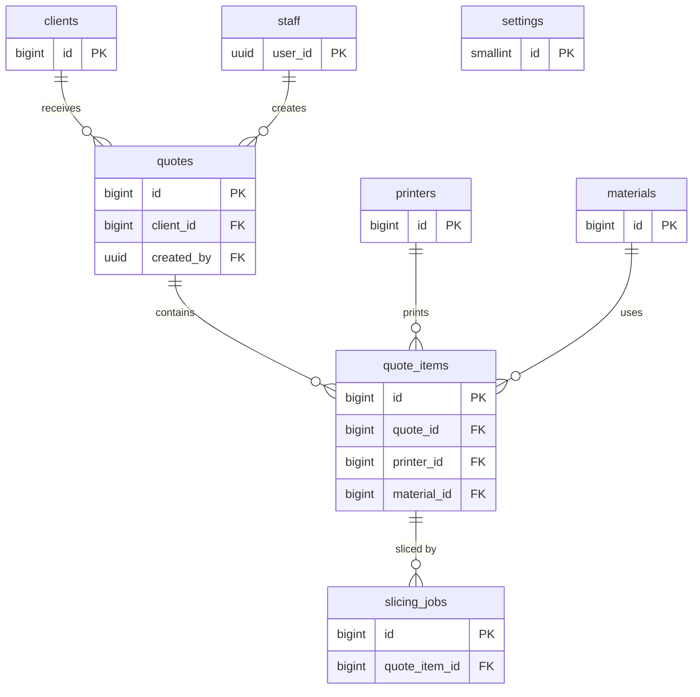

# Data model

- **Status: Implemented** — local only. Source of truth: `supabase/schemas/` and the migrations in
  `supabase/migrations/` ([ADR-0003](../architecture/adr/0003-database-schema-and-security.md)).

## Overview

Pricing runs in an Edge Function (decided 2026-10-11, not built yet). This schema stores the price breakdown, which
only the service role can write.

## Conventions

- Lowercase `snake_case` identifiers, plural table names. Application tables are in `public`; helpers and internal
  tables are in the non-exposed `private` schema.
- Primary keys are `bigint generated always as identity`. The only UUIDs are Supabase Auth user ids.
- Every table has `created_at timestamptz not null default now()`; mutable tables also have `updated_at`, kept
  current by the `private.set_updated_at()` trigger.
- Tables without user-editable state may omit `updated_at`.
- `slicing_jobs` uses `queued_at` instead of `created_at`.
- Money is `numeric(12,2)` in the shop's currency; never floating point.
- Statuses are `text` with a `check` constraint listing the allowed values.
- Every foreign key column gets an index (Postgres does not create one automatically).
- "Today" is always `private.shop_today()`, the date in `Europe/Rome`: quote number years, the send check and the
  expiry job all use it.

## Tables

### `staff`

Who may use the tool. A row links a Supabase Auth user to staff access.

| Column | Type | Notes |
|---|---|---|
| `user_id` | `uuid` PK | References `auth.users(id)`, `on delete cascade` |
| `display_name` | `text` not null | Not blank |
| `role` | `text` not null default `'operator'` | Check: `operator`, `owner` |
| `language` | `text` not null default `'it'` | Check: `it`, `en`. UI language |
| `active` | `boolean` not null default `true` | `false` once removed by an owner; the row is kept so past quotes still show their creator |
| `created_at`, `updated_at` | `timestamptz` | |

Removing a staff member sets `active = false` and bans the Auth user; it never deletes the Auth user. Deleting an
Auth user who created quotes fails on the `quotes.created_by` foreign key. "Invited" vs "Active" in the UI comes from
whether the Auth user has confirmed their invitation.

The `staff_guard` trigger (every role):
- only an owner may change `role` or `active`;
- a change that would leave no active owner raises `last_owner` (demotion, deactivation and deletion).

### `printers`

| Column | Type | Notes |
|---|---|---|
| `id` | `bigint` identity PK | |
| `name` | `text` not null unique | Shop's name for the machine, e.g. "MK4 #2" |
| `model` | `text` not null | Manufacturer model, e.g. "Prusa MK4" |
| `build_x_mm`, `build_y_mm`, `build_z_mm` | `numeric(6,1)` not null | Build volume. Check: `> 0` |
| `nozzle_diameter_mm` | `numeric(3,2)` not null default `0.40` | |
| `hourly_rate` | `numeric(12,2)` not null | Machine cost per hour (wear, depreciation); energy is separate |
| `power_w` | `integer` not null | Check: `> 0`. Average draw while printing, for energy cost |
| `active` | `boolean` not null default `true` | Inactive printers can't be picked for new items |
| `created_at`, `updated_at` | `timestamptz` | |

### `materials`

| Column | Type | Notes |
|---|---|---|
| `id` | `bigint` identity PK | |
| `name` | `text` not null | e.g. "Prusament PETG Galaxy Black" |
| `type` | `text` not null | Check: `PLA`, `PETG`, `ABS`, `ASA`, `TPU`, `PA`, `PC`, `other` |
| `color` | `text` | |
| `density_g_cm3` | `numeric(4,2)` not null | Used to convert filament length to weight |
| `cost_per_kg` | `numeric(12,2)` not null | |
| `active` | `boolean` not null default `true` | |
| `created_at`, `updated_at` | `timestamptz` | |

### `settings`

Shop-wide settings; exactly one row (`id = 1`, enforced by a check constraint), inserted by the `grants_and_setup`
migration. See [functional analysis §3.8](../frontend/functional-analysis.md#38-settings).

| Column | Type | Notes |
|---|---|---|
| `id` | `smallint` PK | Check: `id = 1` |
| `currency` | `text` not null default `'EUR'` | ISO 4217 |
| `energy_price_kwh` | `numeric(8,4)` not null default `0` | |
| `failure_allowance_pct` | `numeric(5,2)` not null default `0` | Check: `0..100` |
| `setup_fee` | `numeric(12,2)` not null default `0` | Per item |
| `default_markup_pct` | `numeric(6,2)` not null default `0` | Check: `>= 0` |
| `minimum_item_price` | `numeric(12,2)` not null default `0` | |
| `vat_rate_pct` | `numeric(5,2)` not null default `22` | Check: `0..100`. The shop's VAT rate; draft quotes follow it |
| `quote_prefix` | `text` not null default `'Q'` | Check: 1–10 letters/digits |
| `default_validity_days` | `smallint` not null default `30` | Check: `1..365` |
| `pdf_terms_it`, `pdf_terms_en` | `text` | |
| `shop_name`, `shop_address`, `shop_vat_number`, `shop_email`, `shop_phone` | `text` | Printed on the PDF |
| `shop_logo_path` | `text` | Object path in the private `branding` bucket |
| `created_at`, `updated_at` | `timestamptz` | |

### `clients`

| Column | Type | Notes |
|---|---|---|
| `id` | `bigint` identity PK | |
| `name` | `text` not null | Contact person or business name |
| `company` | `text` | |
| `email` | `text` | |
| `phone` | `text` | |
| `notes` | `text` | |
| `created_at`, `updated_at` | `timestamptz` | |

### `quotes`

| Column | Type | Notes |
|---|---|---|
| `id` | `bigint` identity PK | |
| `number` | `text` not null unique | e.g. `Q-2026-0042`; built from prefix, year and sequence at insert |
| `number_year`, `number_seq` | `smallint`, `integer` not null | Unique together; the sequence restarts each year |
| `client_id` | `bigint` not null FK → `clients` | Indexed. `on delete restrict`: clients with quotes can't be deleted |
| `status` | `text` not null default `'draft'` | Check: `draft`, `sent`, `accepted`, `rejected`, `expired` |
| `valid_until` | `date` not null | Default today + `settings.default_validity_days` (Europe/Rome) |
| `notes` | `text` | Shown on the quote |
| `created_by` | `uuid` not null default `auth.uid()`, FK → `staff(user_id)` | Indexed |
| `markup_override_pct` | `numeric(6,2)` | Owner only; null = use `settings.default_markup_pct`. Check: `>= 0` |
| `vat_rate_pct` | `numeric(5,2)` | Null while the quote is a draft; `mark_quote_sent` copies `settings.vat_rate_pct` here and it never changes afterwards. Check `quotes_vat_rate_check`: null exactly when `status = 'draft'` |
| `sent_at` | `timestamptz` | Set when status becomes `sent` |
| `created_at`, `updated_at` | `timestamptz` | |

Partial index `(valid_until) where status = 'sent'` serves the expiry job.

Numbers come from `private.quote_counters` (one row per year, `year smallint` PK, `last_seq integer`) in a
before-insert trigger; supplied values are replaced. The sequence is zero-padded to 4 digits and grows past 9999
without being cut.

The `quotes_guard` trigger (every role, the service role included): once a quote leaves `draft`, the only allowed
change is `status` moving from `sent` to `accepted`, `rejected` or `expired`. Anything else, including deleting the
quote, raises `quote_not_draft`.

### `quote_items`

| Column | Type | Notes |
|---|---|---|
| `id` | `bigint` identity PK | |
| `quote_id` | `bigint` not null FK → `quotes`, `on delete cascade` | Indexed |
| `model_path` | `text` not null unique | Object path in the `models` bucket, uploaded before the item is created |
| `original_filename` | `text` not null | |
| `description` | `text` not null | The web app suggests the file name without extension; printed on the PDF |
| `printer_id` | `bigint` FK → `printers`, `on delete restrict` | Indexed. Null until chosen; slicing starts once printer and material are set |
| `material_id` | `bigint` FK → `materials`, `on delete restrict` | Indexed. Same |
| `quantity` | `integer` not null default `1` | Check: `> 0` |
| `layer_height_mm` | `numeric(3,2)` not null default `0.20` | |
| `infill_percent` | `smallint` not null default `20` | Check: `0..100` |
| `supports` | `boolean` not null default `false` | |
| `print_time_s` | `integer` | From the newest succeeded slicing job; null until sliced |
| `filament_g` | `numeric(10,2)` | Same |
| `bbox_x_mm`, `bbox_y_mm`, `bbox_z_mm` | `numeric(6,1)` | Same; checked against the printer's build volume |
| `material_cost`, `machine_cost`, `energy_cost`, `failure_cost`, `setup_fee`, `markup_amount` | `numeric(14,4)` | Price breakdown, full precision ([pricing rules](../frontend/functional-analysis.md#5-pricing-rules)) |
| `markup_pct` | `numeric(6,2)` | Markup % used for this computation |
| `computed_total` | `numeric(12,2)` | After minimum price, rounded |
| `override_total` | `numeric(12,2)` | Owner override; null when none |
| `override_reason` | `text` | Required when `override_total` is set |
| `item_total` | `numeric(12,2)` generated always as `coalesce(override_total, computed_total)` stored | Null until priced |
| `priced_at` | `timestamptz` | Last computation. Never changes once the quote is `sent` |
| `created_at`, `updated_at` | `timestamptz` | |

Check `quote_items_override_check`: `override_total` is null, or it is `>= 0` and `override_reason` is not blank.

Triggers (every role, the service role included):
- `quote_items_guard`: an update or delete raises `quote_not_draft` unless the parent quote is `draft` (the cascade
  from deleting a draft quote is allowed), and moving an item to another quote raises `quote_item_move_not_allowed`.
  It takes `FOR SHARE` on the quote, so it waits for a concurrent send.
- `quote_items_reprice_on_quantity`: a quantity change clears the price breakdown (`material_cost` … `markup_pct`,
  `computed_total`, `priced_at`); the override stays.

### `slicing_jobs`

One row per slicing request for an item. The queue message carries `job_id`; this table is the durable record of
what happened (see [slicer-worker](../services/slicer-worker.md)).

| Column | Type | Notes |
|---|---|---|
| `id` | `bigint` identity PK | |
| `quote_item_id` | `bigint` not null FK → `quote_items`, `on delete cascade` | Index `(quote_item_id, id desc)` serves the FK and "newest job of an item" |
| `status` | `text` not null default `'queued'` | Check: `queued`, `running`, `succeeded`, `failed` |
| `attempts` | `smallint` not null default `0` | The message's `read_ct` when last claimed |
| `error` | `text` | Last error message |
| `print_time_s` | `integer` | Results, see slicer-worker output |
| `filament_g`, `filament_mm` | `numeric(10,2)` | |
| `layer_count` | `integer` | |
| `bbox_x_mm`, `bbox_y_mm`, `bbox_z_mm` | `numeric(6,1)` | |
| `slicer_version` | `text` | |
| `queued_at` | `timestamptz` not null default `now()` | |
| `started_at`, `finished_at` | `timestamptz` | |

## Views

### `quotes_list`

The quotes list (home page). `security_invoker = true`, so the caller's RLS on `quotes`, `clients`, `staff` and
`quote_items` applies: users who aren't active staff see no rows. Declared in `supabase/schemas/08_quotes_list.sql`.

A migration generated with `supabase db diff` recreates the view with `create or replace view` and drops
`security_invoker`, which would show every quote to anyone who can select from the view. Any change to the view
therefore needs `alter view public.quotes_list set (security_invoker = true);` added to its migration by hand.

| Column | Notes |
|---|---|
| `id`, `number`, `number_year`, `number_seq`, `status`, `client_id`, `valid_until`, `sent_at`, `created_at`, `created_by` | From `quotes` |
| `client_name`, `client_company` | From `clients` |
| `created_by_name` | `staff.display_name` of the creator |
| `created_on` | `created_at` as a date in `Europe/Rome`, for the date filter |
| `item_count` | Number of items |
| `total` | Sum of `item_total`; null when there are no items or any item is unpriced |

## Realtime

`quote_items` and `slicing_jobs` are in the `supabase_realtime` publication (migration `quotes_list_setup`; the
declarative schema can't express publications). The quote editor subscribes to them; Realtime applies each table's
`select` RLS, so only active staff receive changes.

## Storage

- Private bucket **`models`**, 100 MB per file, no MIME restriction (browsers report STL and 3MF types
  inconsistently).
- Object path: `<quote_id>/<upload_id>/<original_filename>`, where `upload_id` is a UUID generated in the browser.
  The file is uploaded before the quote item exists, so the item id can't be part of the key.
- Upload rule: the first folder must be the id of a `draft` quote (`private.can_upload_model(name)`).
- Change rule: files in the folder of a quote that has left `draft` can't be moved or deleted by staff
  (`private.can_change_model(name)`); folders of deleted quotes stay removable.
- Objects that no `quote_items.model_path` points to (upload finished, item never created) are orphans; a periodic
  cleanup removes them (proposed).
- The worker downloads with the service role.
- Private bucket **`branding`** for the shop logo, 1 MB, `image/png`, `image/jpeg`, `image/svg+xml`.

Policies on `storage.objects`, all `to authenticated` (declared in `supabase/schemas/30_storage.sql`):

| Policy | Rule |
|---|---|
| `models: staff read` | staff, `models` bucket |
| `models: staff upload to draft quotes` | `private.can_upload_model(name)` |
| `models: staff update in draft quotes` | `private.can_change_model(name)`; the new name must pass `private.can_upload_model(name)` |
| `models: staff delete` | `private.can_change_model(name)` |
| `branding: staff read` | staff |
| `branding: owner upload` | owner |
| `branding: owner update` | owner |
| `branding: owner delete` | owner |

## Queues

- pgmq queue **`slicing_jobs`** (`pgmq.q_slicing_jobs`, archive `pgmq.a_slicing_jobs`), created by the
  `grants_and_setup` migration.
- Messages are sent only by `private.enqueue_slicing_job`, in the same transaction that inserts the `slicing_jobs`
  row. Message format: see [slicer-worker → Job message](../services/slicer-worker.md#job-message).

## Scheduled jobs

- **`expire-quotes`** (pg_cron, `15 0 * * *`, 00:15 UTC): `private.expire_quotes()` sets `status = 'expired'` on
  `sent` quotes whose `valid_until` is before `private.shop_today()`.

## Access

- Row Level Security is enabled on every table in `public` and `private`. `private.quote_counters` has no policies;
  only the numbering trigger reaches it.
- `private.is_staff()` is true when the caller has a `staff` row with `active = true`; `private.is_owner()` also
  requires `role = 'owner'`. Both are `security definer`, `stable`, `set search_path = ''`, and policies call them as
  `(select private.is_staff())` so they run once per statement, not once per row.
- Public sign-ups are disabled in Supabase Auth; staff accounts are created by invitation. Being `authenticated`
  alone grants nothing — a `staff` row is required.
- The slicer-worker uses the service role, which bypasses RLS but not the triggers.

### Grants

Since the 2026 Data API change every grant is explicit. `anon` gets nothing. `authenticated` gets `select` on every
public table plus these writes; `service_role` gets `all`.

| Table | insert | update | delete |
|---|---|---|---|
| `staff` | ✓ | `display_name`, `language`, `role`, `active` | — |
| `printers`, `materials`, `clients` | ✓ | ✓ | ✓ |
| `settings` | — | every column except `id` | — |
| `quotes` | `client_id`, `valid_until`, `notes` | `client_id`, `valid_until`, `notes` | ✓ |
| `quote_items` | — (created by function) | `description`, `quantity` | ✓ |
| `slicing_jobs` | — | — | — |
| `quotes_list` (view) | — | — | — |

`quotes_list` is readable by `authenticated` and `service_role` only.

### RLS policies

Every policy is `to authenticated`. UPDATE policies have both `using` and `with check`.

| Table | select | insert | update | delete |
|---|---|---|---|---|
| `staff` | staff | owner | owner, or the row's own user | — |
| `printers`, `materials` | staff | owner | owner | owner |
| `settings` | staff | — | owner | — |
| `clients` | staff | staff | staff | owner |
| `quotes` | staff | staff | staff, while `status = 'draft'` | owner, while `status = 'draft'` |
| `quote_items` | staff | — | staff, parent quote draft | staff, parent quote draft |
| `slicing_jobs` | staff | — | — | — |

### Functions

Each function in `public` is a `security invoker` SQL wrapper that calls the same-named `security definer` function
in `private`. The private function has `set search_path = ''`, checks `private.is_staff()` or `private.is_owner()`
first, and raises one of the [errors](#errors) below. EXECUTE is revoked from `public` and `anon` everywhere and
granted only as listed. Internal helpers (`require_staff`, `require_owner`, `require_draft_quote`,
`require_active_catalog`, `enqueue_slicing_job`, `mark_quote_outcome`, `expire_quotes`, `require_job_message`) are
`security invoker` and granted to nobody. The storage helpers `can_upload_model` and `can_change_model` are
`security definer` and granted to `authenticated` for the storage policies.

**Web app functions** (`authenticated`):

| Function | Who | Does |
|---|---|---|
| `list_staff() → table(user_id uuid, display_name text, email text, role text, language text, active boolean, created_at timestamptz)` | owner | Every staff row with the login email from `auth.users` (which the API can't read), ordered by display name. Raises `owner_required` for anyone else. |
| `create_quote_item(quote_id bigint, model_path text, original_filename text, description text, printer_id bigint default null, material_id bigint default null, quantity integer default 1, layer_height_mm numeric default 0.20, infill_percent integer default 20, supports boolean default false) → bigint` | staff | Checks the quote is a draft, `model_path` starts with `<quote_id>/`, the object exists in `models`, and the chosen printer and material are active. Inserts the item; if printer and material are set, enqueues a job. Returns the item id. |
| `update_quote_item_settings(item_id bigint, printer_id bigint, material_id bigint, layer_height_mm numeric, infill_percent integer, supports boolean) → void` | staff | Replaces all slicing inputs. If any differ: clears results and price breakdown (override kept) and enqueues a job if printer and material are set. No change → no job. A printer or material that changes must be active. |
| `retry_slicing(item_id bigint) → bigint` | staff | Draft quote, item's newest job `failed` → enqueues a new job, returns its id |
| `set_markup_override(quote_id bigint, pct numeric) → void` | owner | Draft only. `pct >= 0` or null. Clears every item's price breakdown. |
| `set_price_override(item_id bigint, total numeric, reason text) → void` | owner | Draft only. `total >= 0`, reason not blank. |
| `clear_price_override(item_id bigint) → void` | owner | Draft only |
| `get_quote_send_blockers(quote_id bigint) → table(quote_item_id bigint, code text)` | staff | Empty means the quote can be sent |
| `mark_quote_sent(quote_id bigint) → void` | staff | Raises `quote_not_sendable` if there are blockers; otherwise sets `sent` and `sent_at = now()` and freezes the VAT rate |
| `mark_quote_accepted(quote_id bigint)`, `mark_quote_rejected(quote_id bigint) → void` | staff | `sent` quotes only |

**Send blockers:**

| Code | When |
|---|---|
| `not_draft` | Quote is not `draft` (no item id; reported alone) |
| `no_items` | Quote has no items (no item id) |
| `valid_until_past` | `valid_until < private.shop_today()` (no item id) |
| `missing_printer_or_material` | Item has no printer or no material |
| `not_sliced` | Item's newest job is not `succeeded`, or the item has no results |
| `not_priced` | `item_total` is null |
| `does_not_fit` | Any bbox axis exceeds the printer's build volume on the same axis |

**Worker functions** (`service_role` only; each changes the job, the item and the queue message in one transaction).
`worker_complete_job` and `worker_fail_job` raise `job_message_mismatch` when `msg_id` is still queued but carries a
different `job_id`:

| Function | Does |
|---|---|
| `worker_claim_job(visibility_timeout_s integer, max_attempts integer) → table(msg_id bigint, read_ct integer, message jsonb)` | Reads one message. If `read_ct > max_attempts`: fails the job ("worker stopped on every attempt"), archives the message and reads again. A message whose job no longer exists is archived. Otherwise marks the job `running` with `started_at` and `attempts = read_ct` and returns the message. No rows when the queue is empty. |
| `worker_complete_job(msg_id bigint, job_id bigint, results jsonb) → void` | Requires `print_time_s`, `filament_g` and the bbox in `results` (`invalid_results`). Stores the results on the job, marks it `succeeded`, deletes the message. Copies `print_time_s`, `filament_g` and the bbox onto the item only if this is the item's newest job and the quote is a draft. A deleted job: archives the message. |
| `worker_fail_job(msg_id bigint, job_id bigint, error text, final boolean) → void` | Records `error`. `final`: job `failed` with `finished_at`, message archived. Otherwise back to `queued`; the message reappears after its visibility timeout. |

**Service functions** (`service_role`, used by the [`duplicate-quote` Edge Function](edge-functions.md)):

| Function | Does |
|---|---|
| `service_create_quote_copy(source_id bigint, created_by uuid) → bigint` | Inserts a draft with the source's client, notes and markup override; the trigger assigns the number and default validity. Raises `quote_not_found`. |
| `service_copy_quote_items(source_id bigint, new_id bigint, files jsonb) → void` | `files` is `[{item_id, model_path}]`, one per source item, each path under `<new_id>/` and already in `models`. Copies settings, results and price overrides (not the breakdown); a sliced item gets a `succeeded` job, an unsliced one with printer and material is queued. Raises `quote_not_draft`, `invalid_copy`, `invalid_model_path`, `model_not_found`. |

Item prices are written by the [`price-quote` Edge Function](edge-functions.md) with the service role.

## Errors

Functions and triggers raise these exact messages; the web app maps them to translated text. Changing one is a
breaking change.

| errcode | messages |
|---|---|
| `42501` | `not_staff`, `owner_required` |
| `P0001` | `last_owner`, `quote_not_draft`, `quote_not_sent`, `quote_not_sendable`, `retry_not_allowed`, `quote_item_move_not_allowed` |
| `P0002` | `quote_not_found`, `item_not_found`, `model_not_found` |
| `22023` | `invalid_model_path`, `printer_inactive`, `material_inactive`, `invalid_override`, `invalid_markup`, `invalid_results`, `job_message_mismatch`, `invalid_copy` |

## Open questions

- **Soft delete:** whether clients should be archivable (today they can only be deleted when they have no quotes).
